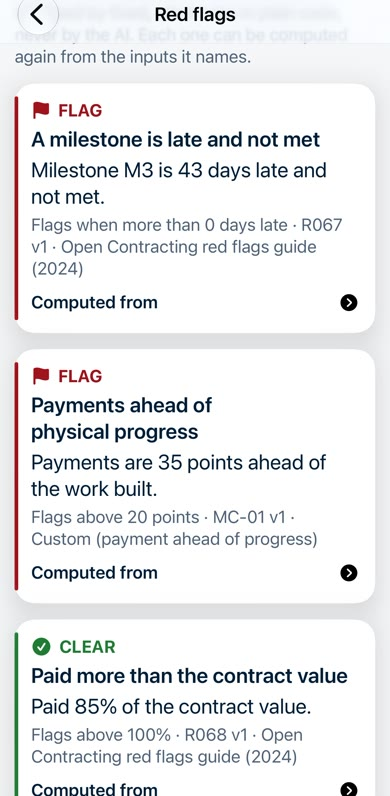
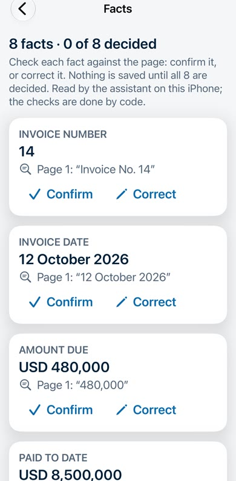
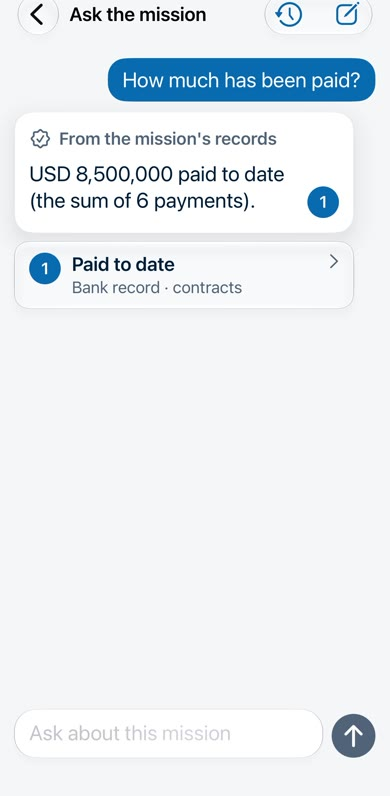
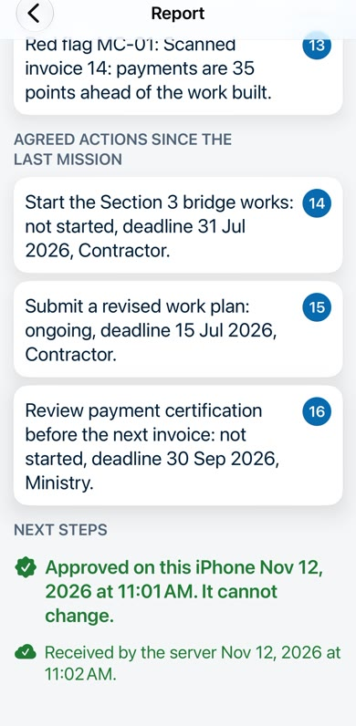
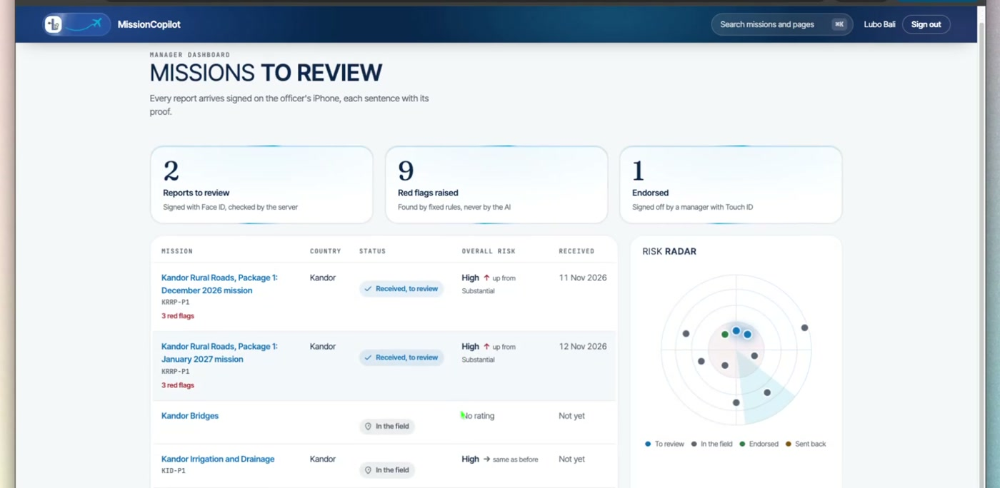
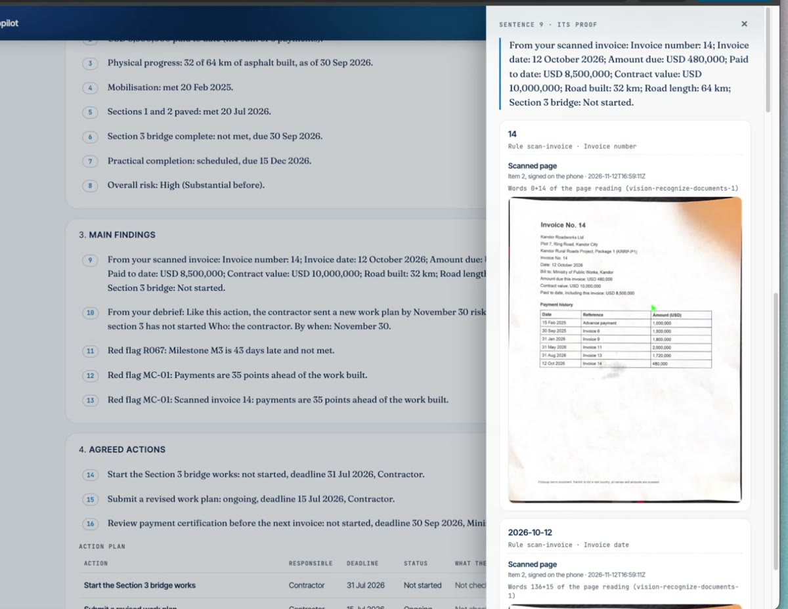
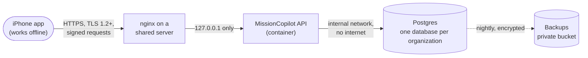

# MissionCopilot-AI

Small, offline AI for evidence-first field supervision. It runs on the iPhone in airplane mode,
keeps sensitive notes on the phone, links every fact to its evidence, and only shares a report
after a human approves it. **An untraceable claim cannot be approved.**

> **Status: done (Nov 12 2026).** All 10 iterations built, from the encrypted store to the manager dashboard, and
> the whole chain recorded on production with a real iPhone in airplane mode. Portfolio project, built in about two
> weeks. Synthetic data only: Kandor is not a real country.

## Demo
An 8-minute video of the whole chain on production: the officer's iPhone offline (download, red flags, site walk,
scan of printed paper, voice debrief, Ask the mission, the report approved with Face ID, sent when back online),
then the manager's dashboard (Touch ID sign-in, the proof behind each sentence, the officer's own voice, endorse).
Watch it on the project page at [lubobali.com](https://lubobali.com).

| Red flags, by code | Facts, each on its page | Ask, offline | Approved and sent |
|---|---|---|---|
|  |  |  |  |

**The manager's dashboard:** every mission in one place, the reports to review, the red flags and a risk radar.

Every sentence of a report opens its proof, here the invoice the officer scanned on site.

It fits any job done on site, away from the office: field supervision of development projects, home inspections,
construction sites, insurance claims, property management, solar and utility work.

## How this project is run

Agile, SAFe style, by one developer working with AI coding agents (so iterations are one day).

| What | Where |
|---|---|
| Kanban board | [MissionCopilot-AI board](https://github.com/users/lubobali/projects/1) |
| Epic and stories | [Issues](https://github.com/lubobali/MissionCopilot-AI/issues) (epic, story, enabler, spike) |
| Iterations | [Milestones](https://github.com/lubobali/MissionCopilot-AI/milestones) |
| Definition of Done | [docs/agile/definition-of-done.md](docs/agile/definition-of-done.md) |
| Iteration reviews | [docs/agile/iteration-reviews.md](docs/agile/iteration-reviews.md) |
| Architecture decisions | [docs/adr/](docs/adr/) |

Every story is built test-first on its own branch and merged by a pull request that closes its
issue, with CI green.

### How CI runs (#127)
- **iOS** ([ios.yml](.github/workflows/ios.yml)): the app job (SwiftLint, the Staging and Release
  server check, build, then the app's tests on a simulator) and the lab job (spikes 14 to 16) run side by
  side. The labs run on every push to main, every Monday, on demand, and on any pull request that
  touches them ([scripts/ios_ci_paths.py](scripts/ios_ci_paths.py), our own `git diff`); one
  "iOS result" check passes only when every needed job did. Measured: a pull request waits about
  13 minutes (it was 22). The floor is the simulator's first boot on a fresh runner, about 6 minutes.
- **Everything else** ([ci.yml](.github/workflows/ci.yml), [security.yml](.github/workflows/security.yml)):
  the same hooks as a local commit, a dependency audit, CodeQL and OpenSSF Scorecard.
- **Safety:** every action pinned by its full commit SHA, least privilege (no write permission), tool
  downloads checked by SHA-256, no caches for builds or packages (measured: they would save about a
  minute and could be poisoned), workflows linted by zizmor.

## What it does
Every part built test-first and proven on an iPhone 13 Pro Max, then on production ([field proof](docs/field-proof.md)).

**On the phone, offline (the AI runs on the iPhone: no cloud, no data):**
- **Connect a phone**: a one-time code, a signing key born in the Secure Enclave, a manager approves it.
- **Download a mission pack**: signed by the server, every file checked, resumes after a cut signal
  ([pack proof](docs/pack-proof.md)); kept encrypted, one key per mission ([store proof](docs/store-proof.md)).
- **Red flags by code, not by AI**: for example "payments are 35 points ahead of the work built", each showing
  the records it comes from ([rules](docs/rules/red-flag-rules.json)).
- **Site walk**: a guided checklist, photos and location kept as signed evidence.
- **Scan paper**: the invoice and the progress report read on the phone; every fact points to its place on the
  page, and code catches a value the AI guessed. Printed paper, flat, tilted, low light, creased: 15 of 16
  pages read every line ([documents spike](docs/spikes/05-documents.md)).
- **Voice debrief**: notes written by code from the officer's own words, linked to the recording.
- **Ask the mission**: answers written by code from the records, each citing its source; the AI only chooses.
- **The report**: written by code, every sentence with its proof, approved with Face ID (a Secure Enclave
  signature), unchangeable after; sent by itself when the phone is back online, only what the report cites.

**On the server and the manager's dashboard:**
- **Sync with every check first**: the approval signature, the evidence chain, the files' hashes.
- **Dashboard**: passkey sign-in (Touch ID), portfolio and risk radar, the report with the proof behind each
  sentence (photo, scanned page, recording), endorse with Touch ID or send back for version 2, and a
  tamper-evident audit trail ("Chain intact").
- **Prompt injection, tested**: 39 attack documents, 6 written knowing the defenses; on the iPhone, without the
  checks 8 got through, with them 2, both forgeries no reading of paper can catch, which is why a person
  approves every report ([injection spike](docs/spikes/08-prompt-injection.md)).

## Architecture
**One-page summary: [docs/architecture-summary.md](docs/architecture-summary.md).** See [docs/architecture.md](docs/architecture.md): system context, containers, trust boundaries and the offline line. [docs/data-classification.md](docs/data-classification.md): labels, lifecycle and the data map. [docs/domain-model.md](docs/domain-model.md): the shared objects and their rules. Decisions in [docs/adr/](docs/adr/).

### Where it runs

Staging and prod are two separate copies of the right side. Details: [ADR 0013](docs/adr/0013-hosting-on-a-shared-server.md), [deploy/RUNBOOK.md](deploy/RUNBOOK.md).

## Security
How field data is protected on the phone (three encryption layers, per-mission crypto-shred, honest limits):
**[docs/security.md](docs/security.md)**. Proven on a real iPhone in [spike #16](docs/spikes/03-encryption.md),
including a check you can repeat yourself, then built in the app and run on the iPhone again
([store proof](docs/store-proof.md)). Not independently audited.

**Reviewing security?** Start with the one-page path: **[docs/security-review.md](docs/security-review.md)**
(threat model, OWASP MASVS matrix, data handling, prompt-injection results, model signing, each with a check
you can run).

## How to run
The backend: `uv run --directory backend pytest` (Postgres from `backend/compose.yaml`). The app: XcodeGen in
`ios/`, then Xcode. Running it against a server needs a signed build and an enrolled phone
([deploy/RUNBOOK.md](deploy/RUNBOOK.md)); running or copying it needs the author's written permission (see License).

## Tests
Backend and tooling: `uv run --directory backend pytest`. iOS: Swift Testing on the simulator.
The app has three builds: Debug (the local server), Staging (its own app, "MC Staging") and Release
(production only); see [docs/security.md](docs/security.md#which-phones-may-send-data-device-enrollment).
Every commit runs the same checks as CI through prek hooks.

## License
**All rights reserved** (see LICENSE). This repository is public to be read, for example to evaluate the
author's work; copying, using, running or changing any of it needs his written permission.
The logo (the L and the key, in `ios/MissionCopilot/Assets.xcassets`), the app icon that shows it and the
airplane mark belong to Lubo Bali, like the code.
AI models are not stored in this repo. Each model keeps its own license, listed in the
architecture decision records.
