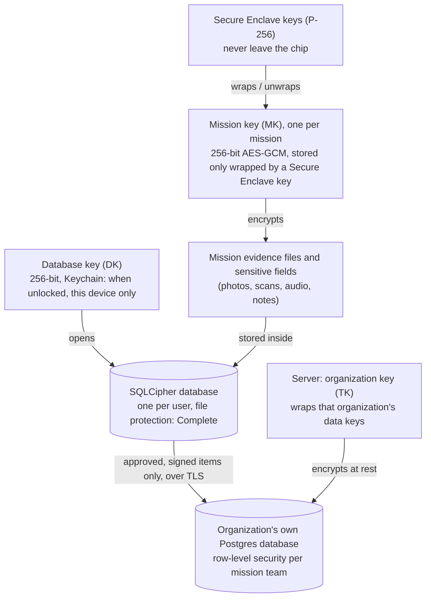

# ADR 0008: Data storage, isolation and encryption

- Status: accepted (feasibility proven in Iteration 2, threat-modelled in Iteration 3)
- Date: 2026-10-30

## Context
Field officers carry confidential mission data on a phone that can be lost, stolen or inspected,
often far from any network. Some items are Strictly Confidential (integrity findings). The server
serves several organizations that must never see each other's data. The data map is in
docs/data-classification.md.

Requirements:
1. A stolen or copied phone must not expose mission data.
2. One mission can be destroyed on purpose without touching the others.
3. Confidential data must not end up in personal cloud backups.
4. Nothing leaves the phone before a person approves it.
5. On the server, one organization can never read another's data.

## Options

### On the phone
1. **iOS Data Protection only.** Files encrypted by the OS with a key tied to the passcode and the chip.
   Simple, but a single layer, and no way to destroy one mission without deleting files.
2. **Data Protection + encrypted database (SQLCipher).** Adds a second layer: a copied database file
   is unreadable without its key.
3. **Data Protection + SQLCipher + one key per mission, wrapped by the Secure Enclave.** Adds
   crypto-shredding: destroy one mission key and that mission's data is unreadable, instantly.

### On the server
1. **Shared database, `tenant_id` column.** Cheap, but one missing filter leaks across organizations.
2. **Schema per organization.** Better, still one database and one set of credentials.
3. **Physical database per organization**, plus row-level security inside each database.

## Decision
Phone: **option 3.** Server: **option 3.**

### Key hierarchy

### Phone rules
1. **One encrypted database per user per phone** (SQLCipher), never shared.
2. **Layer A:** the database and evidence files use iOS file protection **Complete**: unreadable while
   the phone is locked.
3. **Layer B:** the database key (DK) is random, 256-bit, kept in the Keychain as
   **when unlocked, this device only**. It never syncs and never moves to another phone.
4. **Layer C:** each mission gets its own **mission key (MK)**. Evidence files and sensitive fields are
   encrypted with it. The MK is stored only **wrapped** by a Secure Enclave key, whose private part can
   never be exported.
5. **No backups.** The store is excluded from iCloud and device backups; keys are device-only.
6. **Approval gate.** Only approved items, signed with a Secure Enclave signing key, enter the outbox
   (ADR 0006).
7. **Crypto-shred.** When the server confirms receipt, a retention clock starts (default 30 days,
   set per organization). At the end, the wrapped MK is deleted, which makes that mission's data
   unreadable at once; the files are then removed.
8. **App lock.** The app asks for Face ID or the passcode when opened and locks after inactivity.
   Details, with key expiry and what happens to a lost, seized or coerced phone: ADR 0012.

### Server rules
1. **One physical Postgres database per organization**, with its own credentials. No query can join
   across organizations.
2. **Row-level security** inside each database: users see only missions they belong to.
3. **Per-organization keys** encrypt data and backups at rest; TLS in transit.
4. **Cloud AI** receives only items labelled Public (ADR 0003).

## Why
- Three independent layers: breaking one (for example a copied file) does not expose data.
- Per-mission keys make deletion **provable and instant**, which matters for confidential findings.
- Device-only keys and backup exclusion keep data out of personal clouds.
- A database per organization is the strongest isolation that is still simple to run, and the same
  rule this developer already uses in a production multi-tenant SaaS.

## Consequences
- **Unsynced data is lost with the phone.** This is deliberate: losing data is safer than leaking it.
  Mitigation: sync as soon as a mission is approved and a network exists.
- **Sync only runs while the phone is unlocked**, because Complete file protection closes the files
  when locked. Acceptable for field use; uploads resume on the next unlock.
- **No remote wipe while the phone is offline.** Mitigations: app lock, short auto-lock, and in a real
  deployment, device management (MDM).
- **SQLCipher is an extra dependency** (open source); its version and licence are tracked.
- **More keys to test.** Iteration 2 proves the stack on the real phone; Iteration 3 threat-models it.

## Revisit when
- An organization needs managers to read raw evidence without trusting the server (then consider
  end-to-end encryption from phone to manager).
- Several officers must share one mission offline (key sharing between devices).
- Apple changes Data Protection or Secure Enclave behaviour.
