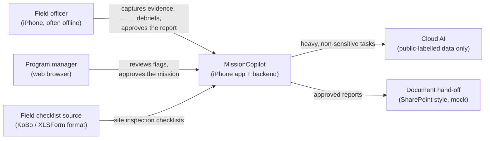
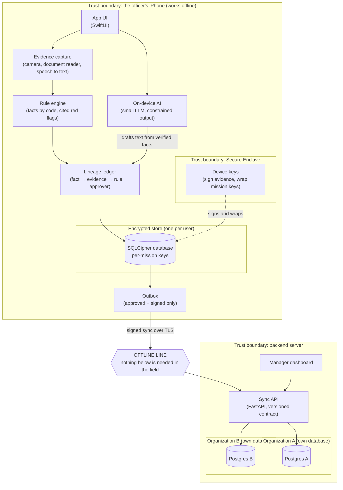

# Architecture

Small, offline AI for evidence-first field supervision. This page shows who uses the system,
what runs where, where data crosses a trust boundary, and where the offline line is.
Decisions behind it live in [docs/adr/](adr/).

## Principles
1. **An untraceable claim cannot be approved.** Every fact links to its evidence, the rule that
   produced it, and the person who approved it.
2. **Data stays where it is created.** Each phone is a sealed node; the server links to approved
   results instead of collecting everything (the "meta grid" idea from metadata management).
3. **Nothing leaves the phone before a human approves it.**
4. **Code does the math, the model writes the words.**
5. **Offline first.** Field work never waits for a network.

## 1. System context

Who uses the system and what it talks to.

| Element | Purpose |
|---|---|
| Field officer | Visits sites, captures evidence and writes the mission report, mostly without internet. |
| Program manager | Reviews risk flags and approves missions from the web dashboard. |
| MissionCopilot | The iPhone app plus the backend described below. |
| Field checklist source | Supplies site inspection checklists in the common KoBo / XLSForm format. |
| Cloud AI | Larger model for heavy tasks, only ever given data labelled public. |
| Document hand-off | Receives approved reports; a mock stand-in for a real document system. |

## 2. Containers, trust boundaries and the offline line

What runs where. Shaded boxes are trust boundaries. Everything inside the phone works with no network.

| Container | Purpose |
|---|---|
| App UI | The officer's screens: mission, capture, flags, report, approval. |
| On-device AI | A small model that turns verified facts and notes into readable text; it never does math. |
| Evidence capture | Takes photos, reads documents and transcribes voice debriefs on the phone. |
| Rule engine | Extracts numbers with code and raises red flags from versioned, cited rules. |
| Lineage ledger | Records where every fact came from, which rule made it, and who approved it. |
| Encrypted store | One SQLCipher database per user, with a separate key for each mission. |
| Secure Enclave | Hardware-protected keys that sign evidence and wrap mission keys; they never leave the chip. |
| Outbox | Holds only approved, signed items until the phone is back online. |
| Sync API | Receives signed, idempotent uploads and serves mission packs, following the API contract. |
| Organization databases | One physical Postgres database per organization, so tenants never share storage. |
| Manager dashboard | Lets managers review flags, approve missions and read the audit trail. |

## 3. Trust boundaries

| Boundary | What crosses it | Protection |
|---|---|---|
| Secure Enclave ↔ app | Signing and key-wrapping requests only | Private keys never leave the hardware |
| Phone ↔ network | Approved, signed items only | TLS, signatures, enrolled Secure Enclave device keys (#46; App Attest needs a paid Apple team) |
| Network ↔ backend | Sync batches and dashboard requests | Authentication, tenant from the token, rate limits, versioned contract (#45) |
| Backend ↔ organization database | One organization's data | Separate database per organization, row-level security per mission team |
| Backend ↔ cloud AI | Data labelled public only | Label check before any call; Official Use Only never leaves |

Details of keys and storage: ADR 0008. Threat model per boundary, with status and tests: [threat-model.md](threat-model.md).
