# Data flow and classification

Every piece of data has an **owner**, a **label**, a **location** and an **encryption key** before
any code stores it. Storage and keys are decided in ADR 0008; this page is the map.

## 1. Labels

| Label | Meaning | Default for |
|---|---|---|
| **Strictly Confidential** | Could harm a person or an investigation if leaked: possible fraud, names linked to a finding, integrity concerns. | Integrity red flags and any note the officer marks sensitive |
| **Official Use Only** | Internal working information of the mission. Shared only with the mission team and its organization. | **Everything new** (secure by default) |
| **Public** | Cleared for wider use. Only a person can set this label, never the app or the model. | Nothing by default |

### Rules
1. **Secure by default.** New data starts as Official Use Only.
2. **Strictest label wins.** Anything derived from other items (a fact from a page, a flag from facts,
   a report sentence from facts) inherits the strictest label among its sources.
3. **Only people lower a label.** Lowering a label is an approval event with a name, a time and a
   reason, written to the audit log.
4. **Labels drive behaviour (active metadata).** The label decides what may be exported, what may be
   synced, and what may ever reach cloud AI.

## 2. Lifecycle

```mermaid
stateDiagram-v2
    direction LR
    [*] --> Prepare
    Prepare: Prepare (online)<br/>mission pack downloaded into the encrypted store
    Prepare --> Field
    Field: Field (offline)<br/>evidence captured, signed, facts extracted, flags raised
    Field --> Draft
    Draft: Draft (offline)<br/>report written from facts, every sentence linked
    Draft --> Approve
    Approve: Approve (offline)<br/>officer approves, untraceable sentences blocked
    Approve --> Outbox
    Outbox: Outbox (offline)<br/>approved, signed items wait for a network
    Outbox --> Sync
    Sync: Sync (online)<br/>signed upload to the organization's own database
    Sync --> Confirmed
    Confirmed: Confirmed<br/>server receipt starts the retention clock
    Confirmed --> Shredded
    Shredded: Crypto-shredded<br/>mission key destroyed on the phone after N days
    Shredded --> [*]
```

## 3. Data map

Key names: **MK** = the mission key (one per mission, wrapped by a Secure Enclave key),
**DK** = the database key (SQLCipher, device-only Keychain), **SE** = Secure Enclave key,
**TK** = the organization's key on the server.

| Data item | Owner | Label | Lives in | Encrypted by | Leaves the phone? | May reach cloud AI? |
|---|---|---|---|---|---|---|
| Mission pack (budget, payments, milestones, last report, site checklist) | Organization | Official Use Only | Phone store; org database | DK + MK; TK | Arrives from server; not re-sent | No |
| Mission list (mission ids, titles, pack versions and dates) | Organization | Official Use Only | Phone store (the last list, for use without a connection); org database | DK; TK | Arrives from server; not re-sent | No |
| Mission pack while it downloads (half-done and checked files) | Organization | Official Use Only | Phone, download folder (not the store) | iOS file protection until first unlock; signed by the server, checked by hash | No | No |
| Voice debrief audio | Field officer | Official Use Only | Phone store | DK + MK | **Never** | No |
| Debrief transcript and notes | Field officer | Official Use Only (or Strictly Confidential if marked) | Phone store | DK + MK | Only inside an approved report | No |
| Photo or scanned page (evidence) | Field officer | Official Use Only | Phone store; org database after approval | DK + MK, signed with SE | After approval, with signature and hash chain | Only if a person labels it Public |
| Extracted fact | System (rule engine) | Inherited from its source | Phone store; org database after approval | DK + MK; TK | After approval | Only if inherited label is Public |
| Risk flag | System (rule engine) | Inherited; integrity flags are Strictly Confidential | Phone store; org database after approval | DK + MK; TK | After approval | No |
| Report sentence | Field officer (approved) | Strictest of its linked facts | Phone store; org database after approval | DK + MK; TK | After approval | Only if Public |
| Approval record | Approver | Official Use Only, immutable | Phone store; org database | DK + MK; TK | Yes, signed | No |
| Audit event | System | Official Use Only, immutable | Phone store; org database | DK + MK; TK | Yes, signed | No |
| Device signing key | Device | Secret | Secure Enclave | Hardware | **Never** (cannot be exported) | No |
| Mission key | Device | Secret | Keychain, wrapped by SE | SE | **Never**; destroyed at crypto-shred | No |
| Database key | Device | Secret | Keychain, this device only | Hardware-backed Keychain | **Never** | No |
| Device registration (public key, status) | Organization | Official Use Only | Org database | TK | Public key only, at enrollment | No |
| Client IP address (audit log, server logs) | Organization | Official Use Only, personal data | Directory (audit events); the server's nginx and API logs | Database access control; logs readable by the server's administrators only | It is the phone's own address, seen by the server | No |
| Server signing key | Organization | Secret | The server's secrets folder (prod's spare: off the server) | File permissions (one owner, 0600) | Public half only (pinned in the app) | No |
| Backups (every database, the roles, the server's secrets) | Organization | Secret | The environment's own restic repository in a private bucket | restic (AES-256, its own password) and the bucket's encryption | Server only, to its own backup bucket | No |
| Shred record (mission, reason, time) | System | Official Use Only | Phone store; org database after sync | DK; TK | Yes, on the next sync | No |
| Site checklist answers (and the finished walk, #129) | Field officer | Official Use Only | Phone store | DK + MK | Only in an approved report, after sync (Phase 8) | No |
| Agreed action checks (what was seen, a note, #129) | Field officer | Official Use Only | Phone store | DK + MK | Only in an approved report, after sync (Phase 8) | No |
| The officer's location at the sample point (a checklist answer, #129) | Field officer | Official Use Only, personal data | Phone store, inside the answer | DK + MK | Only in an approved report, after sync (Phase 8) | No |

## 4. What this map guarantees

- No item is missing an owner, a label, a location or a key.
- Raw voice recordings and all keys never leave the phone.
- Nothing labelled Official Use Only or Strictly Confidential can reach cloud AI.
- Integrity findings are always Strictly Confidential, through inheritance.
- After the server confirms receipt, the phone's copy is crypto-shredded on schedule.
