# Field Navy theme

The app's look (#87): a calm navy and blue palette that reads well outdoors, with the developer's logo.
Every color on screen comes from one file, `ios/MissionCopilot/Platform/Theme/Palette.swift`, as a
named role. Screens never use raw colors or fixed text sizes; a commit guard (`scripts/check_theme.py`)
fails if they do.

## Rules

- **Readable text, checked by a test.** Every text role on every background it sits on reaches 4.5:1
  (WCAG 2.2 AA) in light and dark, and 7:1 (AAA) when the phone's Increase Contrast is on
  (`ios/MissionCopilotTests/ContrastTests.swift`).
- **The cyan is decoration only.** It is 2.80:1 on the light background, too faint for text, so
  it is not a text role and the test proves it is never used as one.
- **Status is never color alone.** Every pack state shows an icon and words, each state its own
  (`StatusLabel`, WCAG 1.4.1).
- **Big enough to hit.** Main buttons at least 48 pt high, every other tap target at least 44 pt,
  measured on a rendered button in the tests.
- **Text follows the person's text size.** Only Dynamic Type text styles; the large icons and the logo
  grow with the text size too.
- **The logo sits on a white tile.** Its dark blue and black would vanish on the dark background, so
  in the app and on the launch screen it sits on white, like the app icon.

## Colors

| Role | Light | Dark | Light, more contrast | Dark, more contrast |
|---|---|---|---|---|
| background | `#F5F7F9` | `#0B1220` | `#FFFFFF` | `#000000` |
| surface | `#FFFFFF` | `#121A2B` | `#FFFFFF` | `#0B1220` |
| border | `#E7EDF3` | `#24304A` | `#586E84` | `#8AA0B6` |
| text | `#002244` | `#F5F7F9` | `#001126` | `#FFFFFF` |
| secondaryText | `#586E84` | `#8AA0B6` | `#3E5266` | `#C2D0DD` |
| accent | `#0071BC` | `#4DA3E0` | `#005A96` | `#8CC8F0` |
| onAccent | `#FFFFFF` | `#0B1220` | `#FFFFFF` | `#000000` |
| success | `#1B7A3A` | `#5CC27A` | `#0F5C2A` | `#8EDDA4` |
| warning | `#8A5300` | `#F2B84B` | `#6B4000` | `#FFD285` |
| danger | `#B3261E` | `#FF8A80` | `#8C1D17` | `#FFB3AD` |
| decoration | `#009FDA` | `#33B5E5` | `#0071BC` | `#66CBEF` |

## Contrast (computed from the values above)

| Text on | Light | Dark | Light, more contrast | Dark, more contrast |
|---|---|---|---|---|
| text on background | 14.9 | 17.4 | 19.0 | 21.0 |
| secondaryText on background | 4.9 | 6.9 | 8.1 | 13.4 |
| accent on background | 4.8 | 6.8 | 7.2 | 11.6 |
| success on background | 5.0 | 8.4 | 8.1 | 13.0 |
| warning on background | 5.9 | 10.5 | 8.9 | 14.8 |
| danger on background | 6.1 | 8.2 | 9.1 | 12.3 |
| onAccent on accent | 5.1 | 6.8 | 7.2 | 11.6 |

Lowest in each mode: 4.8, 6.8, 7.2, 11.6. The same pairs on the
surface color are in the test too.

## Screens

Light, dark and the largest text size, all drawn by `ios/MissionCopilotTests/ScreenshotTests.swift` (the
system Face ID sheet hides a live lock screen). The home pictures show the top of the home screen: the
brand medallion at rest (the tests turn its motion off) above the app's name.

| Lock, light | Lock, dark | Lock, largest text | Cover, dark |
|---|---|---|---|
| 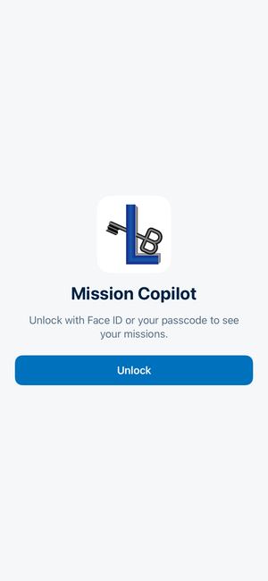 | 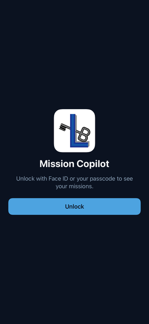 | 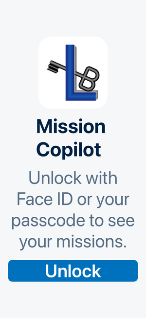 | 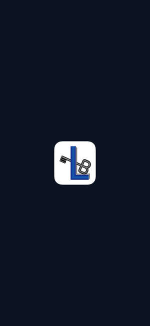 |

| Home, light | Home, dark | Home, largest text |
|---|---|---|
| 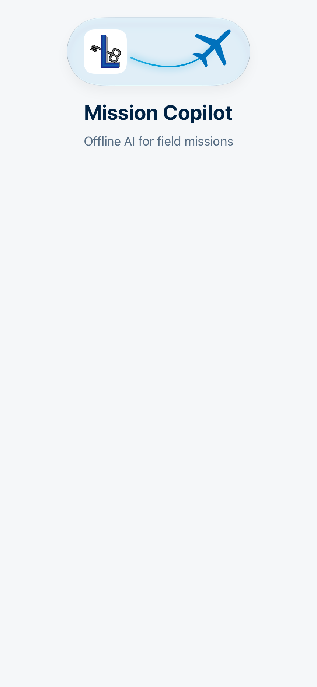 | 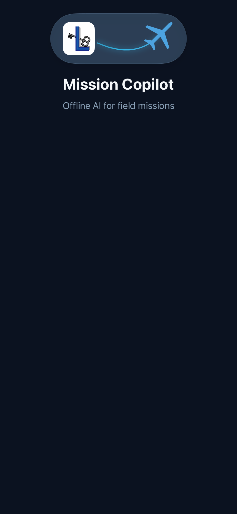 | 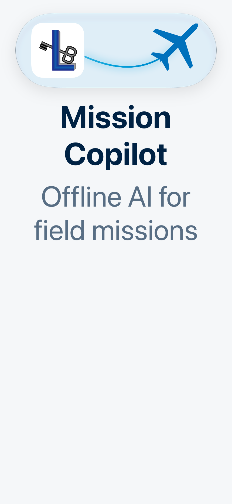 |

| Missions, light | Missions, dark | Missions, largest text |
|---|---|---|
| 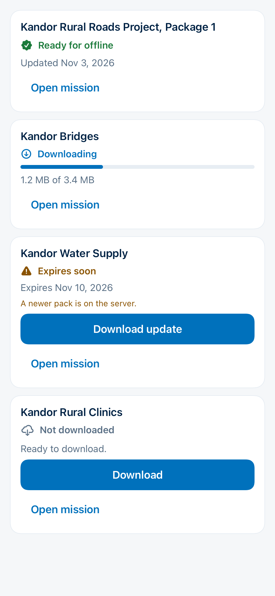 | 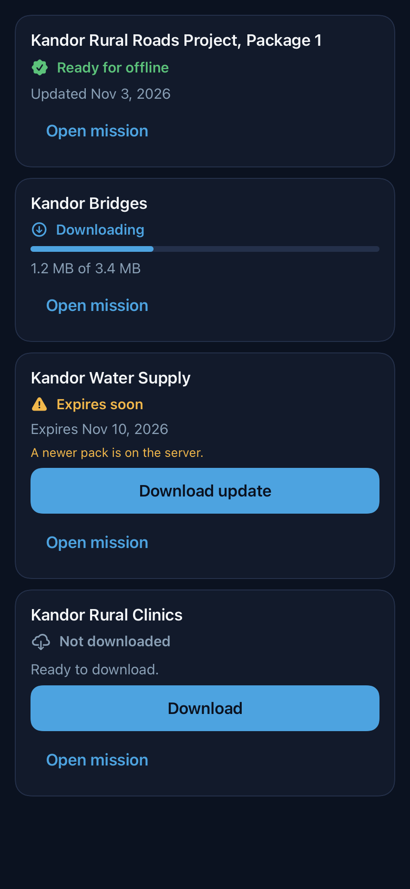 | 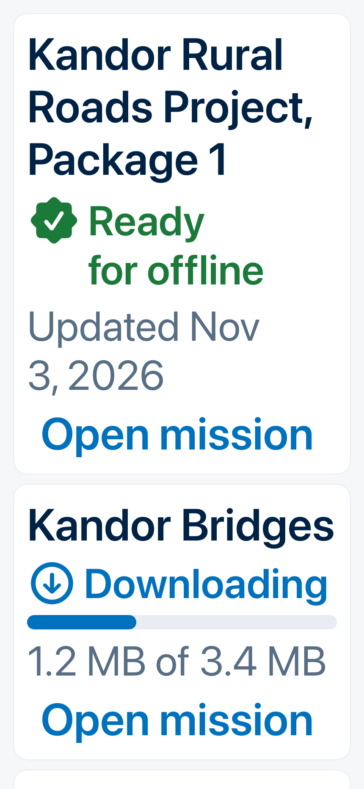 |

| Pack, light | Pack, dark | Pack, largest text |
|---|---|---|
| 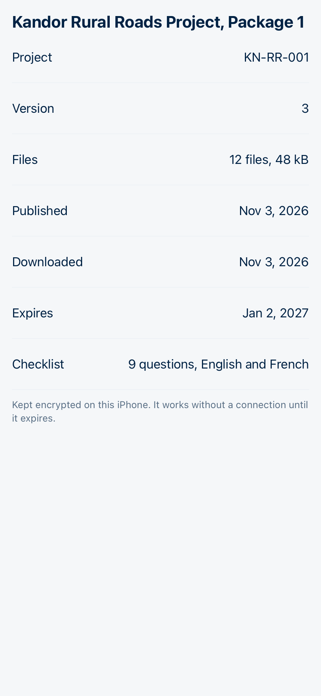 | 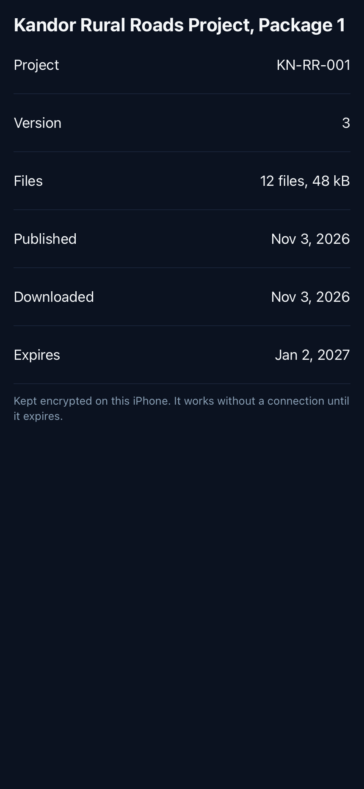 | 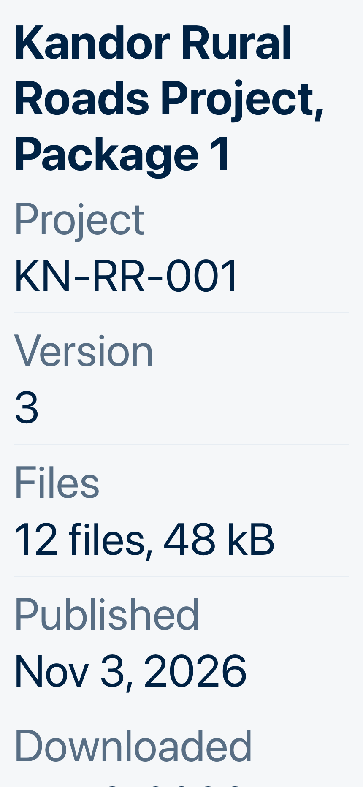 |

The mission list and the pack summary (#92) are drawn by the same tests from fictional Kandor rows: one
mission Ready, one downloading, one expiring with an update on the server, one not downloaded. The
tests draw the content without its scrolling frame and title bar (ImageRenderer draws neither), check a
pixel inside the first card is the surface color, and fail on a picture that is only background. At the
largest text sizes the cards grow and wrap instead of cutting words, and the summary puts each label
above its value.

## The logo, the airplane and the icon (#123)

The L and the key belong to Lubo Bali and are **not** covered by the MIT license (README). The airplane is
our own drawing (`scripts/airplane_mark.py`, under MIT): one mirror-symmetric outline, turned to fly up and
to the right. It is not Apple's SF Symbol, because Apple's license does not allow its symbols, or anything
like them, in app icons or logos. The asset catalog keeps the airplane as a template vector, so the theme
colors it and it stays sharp at every text size.

**Home screen: the brand medallion.** The logo and the airplane at 60 pt on one piece of Liquid Glass.
When it appears, a glowing trail draws itself from the logo and the plane flies a takeoff curve to its
place (`FlightArc`, tested); then the trail glows softly and a pill-shaped reflection crosses the glass,
left to right, in a loop. Tapping it flies again. With Reduce Motion nothing moves. It grows with the text
up to 1.5 times, so it never gets wider than the screen. VoiceOver skips it: the title below names the app.
Its look was tuned on the iPhone with Lubo (size, the reflection's shape and speed).

**App icon.** Split on the diagonal: the logo on the white top-left half, our white airplane on the navy
bottom-right half (the theme's text color, read from `Palette.swift`). Each mark sits in the largest
circle that fits its half, less 40 px, so it never touches the diagonal, an edge, or the corners iOS
rounds off. Checked on the iPhone on the Home Screen and in iOS's dark and tinted looks, which iOS makes
from the icon by itself. The first icon (the logo alone on white) stays in the script as the fallback.

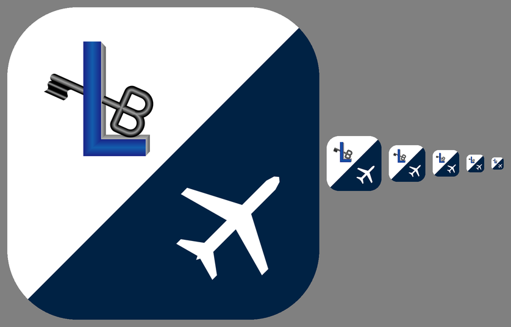

The icon, the logo images, the airplane and the launch tile are built from the source file by
`scripts/make_brand_assets.py` (`--preview` draws the sizes above), which also reads the launch background
from `Palette.swift` so the two cannot drift.
