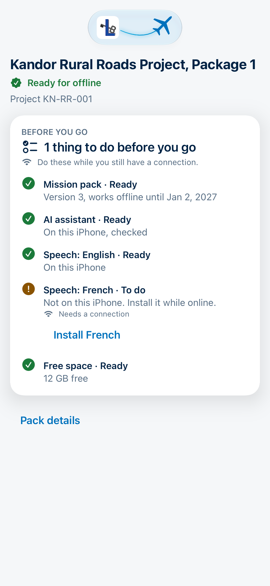
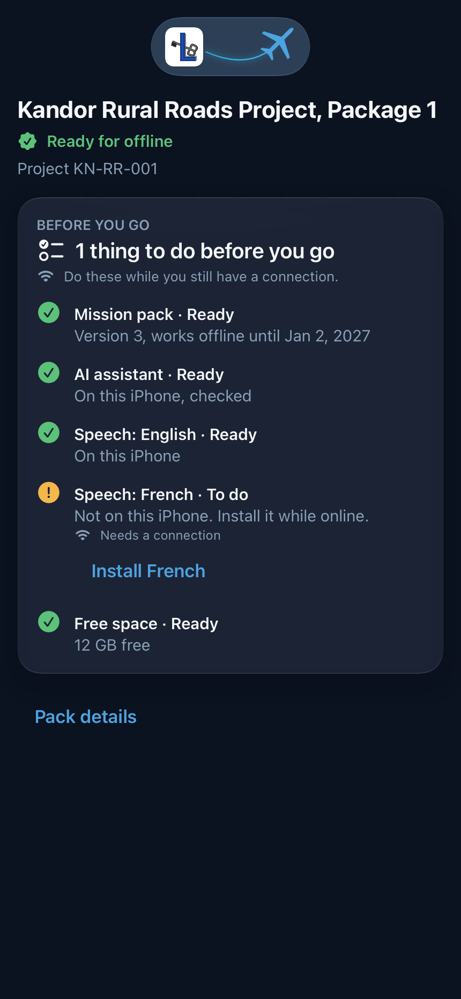
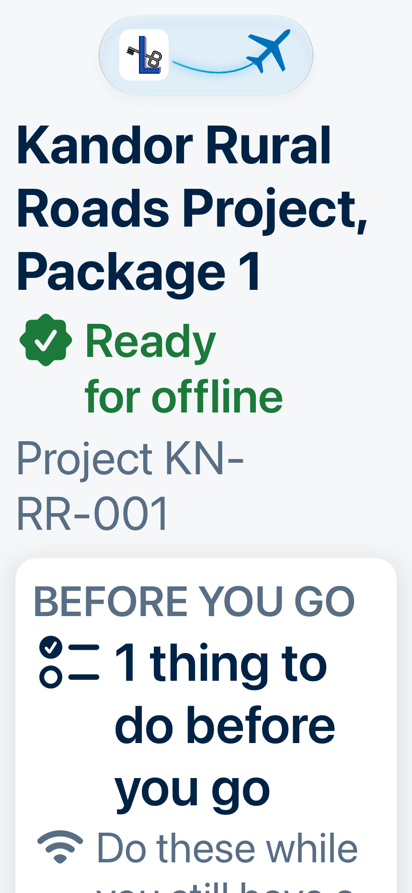

# Field Navy theme

The app's look (#87): a calm navy and blue palette that reads well outdoors, with the developer's logo.
Every color on screen comes from one file, `ios/MissionCopilot/Platform/Theme/Palette.swift`, as a
named role. Screens never use raw colors or fixed text sizes; a commit guard (`scripts/check_theme.py`)
fails if they do.

## Rules

- **Readable text, checked by a test.** Every text role on every background it sits on reaches 4.5:1
  (WCAG 2.2 AA) in light and dark, and 7:1 (AAA) when the phone's Increase Contrast is on
  (`ios/MissionCopilotTests/ContrastTests.swift`).
- **The cyan is decoration only.** It is 2.80:1 on the light background, too faint for text, so
  it is not a text role and the test proves it is never used as one.
- **Status is never color alone.** Every pack state shows an icon and words, each state its own
  (`StatusLabel`, WCAG 1.4.1).
- **Big enough to hit.** Main buttons at least 48 pt high, every other tap target at least 44 pt,
  measured on a rendered button in the tests.
- **Text follows the person's text size.** Only Dynamic Type text styles; the large icons and the logo
  grow with the text size too.
- **The logo sits on a white tile.** Its dark blue and black would vanish on the dark background, so
  in the app and on the launch screen it sits on white, like the app icon.

## Colors

| Role | Light | Dark | Light, more contrast | Dark, more contrast |
|---|---|---|---|---|
| background | `#F5F7F9` | `#0B1220` | `#FFFFFF` | `#000000` |
| surface | `#FFFFFF` | `#121A2B` | `#FFFFFF` | `#0B1220` |
| border | `#E7EDF3` | `#24304A` | `#586E84` | `#8AA0B6` |
| text | `#002244` | `#F5F7F9` | `#001126` | `#FFFFFF` |
| secondaryText | `#586E84` | `#8AA0B6` | `#3E5266` | `#C2D0DD` |
| accent | `#0071BC` | `#4DA3E0` | `#005A96` | `#8CC8F0` |
| onAccent | `#FFFFFF` | `#0B1220` | `#FFFFFF` | `#000000` |
| success | `#1B7A3A` | `#5CC27A` | `#0F5C2A` | `#8EDDA4` |
| warning | `#8A5300` | `#F2B84B` | `#6B4000` | `#FFD285` |
| danger | `#B3261E` | `#FF8A80` | `#8C1D17` | `#FFB3AD` |
| decoration | `#009FDA` | `#33B5E5` | `#0071BC` | `#66CBEF` |

## Contrast (computed from the values above)

| Text on | Light | Dark | Light, more contrast | Dark, more contrast |
|---|---|---|---|---|
| text on background | 14.9 | 17.4 | 19.0 | 21.0 |
| secondaryText on background | 4.9 | 6.9 | 8.1 | 13.4 |
| accent on background | 4.8 | 6.8 | 7.2 | 11.6 |
| success on background | 5.0 | 8.4 | 8.1 | 13.0 |
| warning on background | 5.9 | 10.5 | 8.9 | 14.8 |
| danger on background | 6.1 | 8.2 | 9.1 | 12.3 |
| onAccent on accent | 5.1 | 6.8 | 7.2 | 11.6 |

Lowest in each mode: 4.8, 6.8, 7.2, 11.6. The same pairs on the
surface color are in the test too.

## Screens

Light, dark and the largest text size, all drawn by `ios/MissionCopilotTests/ScreenshotTests.swift` (the
system Face ID sheet hides a live lock screen). The home pictures show the top of the home screen: the
brand medallion at rest (the tests turn its motion off) above the app's name.

| Lock, light | Lock, dark | Lock, largest text | Cover, dark |
|---|---|---|---|
|  |  |  |  |

| Home, light | Home, dark | Home, largest text |
|---|---|---|
|  |  |  |

| Workspace, light | Workspace, dark | Workspace, largest text |
|---|---|---|
|  |  |  |

The mission workspace (#125) opens from "Open mission" on a card: a small, still medallion, the mission and
its pack, and **Before you go** on glass. Each line is an icon and words (Ready, Getting ready, To do, Not
available), never color alone; a speech language that is missing has its Install button, and what needs a
connection says so. The small medallion is an exact copy of the home one: its marks take its own scale, so
nothing spills out at any text size.

| Missions, light | Missions, dark | Missions, largest text |
|---|---|---|
|  |  |  |

| Pack, light | Pack, dark | Pack, largest text |
|---|---|---|
|  |  |  |

The mission list and the pack summary (#92) are drawn by the same tests from fictional Kandor rows: one
mission Ready, one downloading, one expiring with an update on the server, one not downloaded. The
tests draw the content without its scrolling frame and title bar (ImageRenderer draws neither), check a
pixel inside the first card is the surface color, and fail on a picture that is only background. At the
largest text sizes the cards grow and wrap instead of cutting words, and the summary puts each label
above its value.

## The site walk (#129)

The workspace's **Site walk** card shows its progress and opens the walk: the agreed actions from the
last mission first (who and by when, Overdue, four large choices with an icon and words each, a note),
then the site checklist in form order with a control per question type (choice buttons, multiple
choice, number and decimal pads, text, a date, Record location), then Finish or what is still to do.
Every target is at least 48 pt for gloves and one hand; the cards are glass, like Before you go. With
Français on the whole page is French: the form's own words from the pack, and the walk's words, dates
and messages; the agreed actions stay as the pack gives them and say so (#131 brings their French).

No pictures here: the test renderer draws text fields and the language switch as placeholders, and the
iPhone screenshots of the proof stay private. The tests check the screens' words in both languages
(`SiteWalkWordsTests`) and draw the walk and the French checklist on the theme background.

## Red flags (#134)

A **Red flags** card sits under the Site walk card on the workspace and at the top of the walk; it says
the count ("2 flags · 2 clear · 2 not checked"), with a red flag when any rule flags and a green shield
when none does. The page opens with that summary, whether the flags are live or stored at the finish,
and one line saying they come from fixed, cited rules in plain code, never the AI. Then one glass card
per result: flags first, then clear, then not checked, each with a thin edge in its outcome's colour
(danger, success, secondary text), the outcome in capitals, the rule's title, one sentence from its own
numbers ("Payments are 35 points ahead of the work built."), the threshold, the rule's id, version and
source, and a folded "Computed from" list naming each pack field or photo. English or French with the
walk; the rule sources stay as cited.

Screenshots (tests, not committed): red-flags-en light, dark and largest text, red-flags-fr light,
red-flags-card in all three looks.

## The logo, the airplane and the icon (#123)

The L and the key belong to Lubo Bali and are **not** covered by the MIT license (README). The airplane is
our own drawing (`scripts/airplane_mark.py`, under MIT): one mirror-symmetric outline, turned to fly up and
to the right. It is not Apple's SF Symbol, because Apple's license does not allow its symbols, or anything
like them, in app icons or logos. The asset catalog keeps the airplane as a template vector, so the theme
colors it and it stays sharp at every text size.

**Home screen: the brand medallion.** The logo and the airplane at 60 pt on one piece of Liquid Glass.
When it appears, a glowing trail draws itself from the logo and the plane flies a takeoff curve to its
place (`FlightArc`, tested); then the trail glows softly and a pill-shaped reflection crosses the glass,
left to right, in a loop. Tapping it flies again. With Reduce Motion nothing moves. It grows with the text
up to 1.5 times, so it never gets wider than the screen. VoiceOver skips it: the title below names the app.
Its look was tuned on the iPhone with Lubo (size, the reflection's shape and speed).

**App icon.** Split on the diagonal: the logo on the white top-left half, our white airplane on the navy
bottom-right half (the theme's text color, read from `Palette.swift`). Each mark sits in the largest
circle that fits its half, less 40 px, so it never touches the diagonal, an edge, or the corners iOS
rounds off. Checked on the iPhone on the Home Screen and in iOS's dark and tinted looks, which iOS makes
from the icon by itself. The first icon (the logo alone on white) stays in the script as the fallback.

The icon, the logo images, the airplane and the launch tile are built from the source file by
`scripts/make_brand_assets.py` (`--preview` draws the sizes above), which also reads the launch background
from `Palette.swift` so the two cannot drift.
