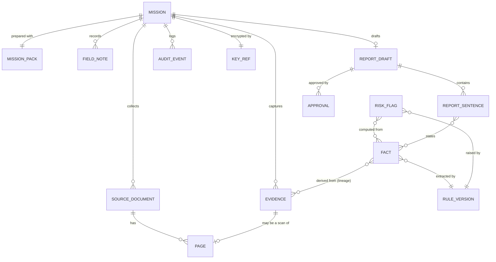

# Domain model

The shared language of the iPhone app and the backend. A Swift type and a Python type with the same
name mean the same thing. The API contract (docs/api/openapi.yaml) is generated from this model.

## 1. Overview

## 2. Objects

Common fields on every object: `id` (UUID), `mission_id` (except Mission), `created_at` (UTC),
`classification` (Strictly Confidential, Official Use Only, Public).

| Object | Key fields | Created by | Mutable? |
|---|---|---|---|
| **Mission** | `organization_id`, `project_ref`, `site`, `start_date`, `end_date`, `team` (user ids), `status` (preparing, in field, drafting, approved, synced, confirmed, shredded) | Organization (online) | Status only |
| **MissionPack** | `budget`, `contract_value`, `payments[]`, `milestones[]`, `last_report_summary`, `checklist` (XLSForm), `downloaded_at` | Backend | No (replaced by a newer pack) |
| **SourceDocument** | `kind` (invoice, progress report, letter, other), `title`, `language`, `page_count` | Officer (scan or import) | No |
| **Page** | `document_id`, `number`, `text`, `tables`, `evidence_id` | Device (text recognition) | No |
| **Evidence** | `kind` (photo, scan, audio), `content_hash` (SHA-256), `prev_hash`, `signature`, `captured_at`, `clock_source`, `location` (optional), `file_ref` (encrypted with the mission key) | Device | **Immutable** |
| **FieldNote** | `source` (typed, debrief), `text`, `audio_evidence_id` (optional), `consent` (for recordings) | Officer / device | Until approval |
| **RuleVersion** | `rule_id` (R067, R068, MC-01 ...), `version`, `source`, `formula`, `threshold` | Organization / app release | **Immutable** |
| **Fact** | `name` (for example `payments_total`), `value`, `unit`, `source_evidence_ids[]`, `region` (page area or time range), `rule_version_id`, `quality` (complete, consistent, valid) | Rule engine (code) | **Immutable** (a correction is a new Fact) |
| **RiskFlag** | `rule_version_id`, `input_fact_ids[]`, `computed_values`, `threshold`, `status` (raised, not checked, dismissed with reason) | Rule engine (code) | Status only, with reason |
| **ReportDraft** | `template` (Aide-Memoire style), `sections[]`, `version` | Model (words) + officer (edits) | Until approval |
| **ReportSentence** | `section`, `text`, `fact_ids[]` (must not be empty to be approved) | Model + officer | Until approval |
| **Approval** | `target` (report draft, label change, flag dismissal), `approver_id`, `decision`, `reason`, `signature` | Person | **Immutable** |
| **AuditEvent** | `actor` (person or device), `action`, `target_id`, `details`, `prev_hash` | System | **Immutable** (hash-chained) |
| **KeyRef** | `key_kind` (mission key), `wrapped_key`, `wrapping_key_ref` (Secure Enclave), `created_at`, `shred_after` | Device | Deleted at crypto-shred |

## 3. Invariants (enforced by code and tests)
1. A **ReportSentence** with no `fact_ids` blocks approval.
2. A **Fact** with no `source_evidence_ids` cannot be linked to a sentence.
3. Facts and flags never come from the model; only the rule engine creates them.
4. `classification` of a derived object is the strictest of its inputs.
5. Immutable objects are never updated; a change creates a new object plus an AuditEvent.
6. Evidence and AuditEvent hash chains must verify end to end.

## 4. Every step and every pain maps to an object

| User step / field pain | Objects |
|---|---|
| Prepare mission online | Mission, MissionPack, KeyRef |
| Scan an invoice or progress report | Evidence, SourceDocument, Page, Fact |
| Payment ahead of real progress | Fact, RuleVersion (MC-01), RiskFlag |
| Voice debrief after a meeting | Evidence (audio), FieldNote |
| Guided site inspection when a full visit is hard | MissionPack.checklist, FieldNote, Evidence |
| Report that drifts from what was seen (candor gap) | ReportSentence.fact_ids, Approval gate |
| "What was promised last mission?" (handover) | MissionPack.last_report_summary, Fact, FieldNote |
| Confidential findings | classification, KeyRef, Approval (label change) |
| Approve and send | Approval, AuditEvent, outbox (ADR 0006) |
| Delete a mission safely later | KeyRef (crypto-shred), AuditEvent |
