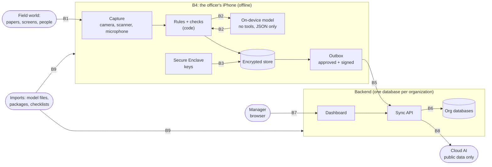

# Threat model

**Status:** first version, Nov 1 2026, on the architecture after the feasibility spikes. Not independently
reviewed. A guard (`scripts/check_threat_model.py`, run in CI) fails if a row claims a control that the repo
does not show: "built" must name an existing test or file, everything else must name the phase or issue that
fixes it.

**Method:** the four questions of the [Threat Modeling Manifesto](https://www.threatmodelingmanifesto.org/):
what are we working on, what can go wrong (STRIDE per trust boundary, LINDDUN for privacy, MITRE ATLAS for
AI), what are we doing about it, did we do a good job.

**Status words:** **built** (in the main code, with the test or the config file that enforces it), **spike** (proven on the real iPhone in a spike, to
be rebuilt test-first in the app), **planned** (decided, not built), **accepted** (a known limit, with the
reason).

## 1. What we are working on

Assets, by label ([data classification](data-classification.md)): mission evidence (photos, scans, voice,
transcripts, extracted facts, reports) is **Official Use Only** by default; device and mission keys never
leave the phone; public data only may reach cloud AI.

| Boundary | What crosses it |
|---|---|
| B1 Field world → phone | Documents, screens, speech: untrusted content that may carry instructions |
| B2 App ↔ on-device model | Untrusted text in, constrained JSON out |
| B3 App ↔ Secure Enclave | Signing and key-wrapping requests |
| B4 The phone itself | Everything at rest, on a phone that can be lost, stolen or seized |
| B5 Phone → network → backend | Approved, signed sync batches |
| B6 Backend ↔ organization databases | One organization's data |
| B7 Manager browser ↔ backend | Dashboard sessions and approvals |
| B8 Backend ↔ cloud AI | Public-labelled data only |
| B9 Imports (supply chain) | Model files, code dependencies, CI actions, checklists, mission packs |

## 2. What can go wrong, and what we do about it (STRIDE)

S spoofing, T tampering, R repudiation, I information disclosure, D denial of service, E elevation of privilege.

### B1 Field world → phone
| ID | STRIDE | Threat | Control | Status | Test or phase |
|---|---|---|---|---|---|
| T01 | S | A forged invoice is scanned as real | Values must be grounded in the scan; code cross-checks; a person approves | spike | `ios/AILab/DocumentLab/Tests/DocumentLabTests/GroundingTests.swift`, rebuild Phase 6 |
| T02 | T | Hidden instruction in a scanned page (indirect prompt injection, ATLAS AML.T0051.001) | Model has no tools, output is constrained JSON, values grounded, human approval | spike | `ios/AILab/DocumentLab/Tests/DocumentLabTests/GroundingTests.swift`, measured in #48 |
| T03 | T | A fake second total that IS in the text passes grounding | Code cross-checks: payment lines add up, dates inside the contract | planned | #48 |
| T04 | T | A spoken number is misheard or injected | Spoken numbers are "heard" until the speaker confirms; cross-checked (ADR 0005) | planned | Phase 6, injection cases in #48 |
| T05 | I | A photo captures unrelated personal content (screens, bystanders) | Photos stay on the phone, encrypted; logs keep counts only | planned | Phase 4, handling sheet #49 |
| T06 | D | Very long or malformed input stalls the model | Input length cap, token limit, timeout (LLM10) | planned | #48 |

### B2 App ↔ on-device model
| ID | STRIDE | Threat | Control | Status | Test or phase |
|---|---|---|---|---|---|
| T07 | T | Model output lowers a risk (e.g. hides MC-01) | Code computes every flag; the model never decides one (ADR 0005) | spike | `ios/AILab/DocumentLab/Tests/DocumentLabTests/GroundingTests.swift`, rebuild Phase 6 |
| T08 | E | Model takes actions (excessive agency, LLM06) | No tools, no network, no memory across documents | planned | #48 (test that no tools are passed), Phase 6 |
| T09 | R | Nobody can tell which text produced a value | Lineage: each fact keeps source, rule and approver (ADR 0009) | planned | Phase 4 |
| T10 | I | One mission's data leaks into another's draft | One mission per prompt, fresh session each time | planned | Phase 7 |

### B3 App ↔ Secure Enclave
| ID | STRIDE | Threat | Control | Status | Test or phase |
|---|---|---|---|---|---|
| T11 | S | Someone signs evidence with the officer's key | Secure Enclave key, this device only, used only by our app | spike | `ios/AILab/EncryptionLab/Tests/EncryptionLabTests/EvidenceChainTests.swift`, rebuild Phase 4 |
| T12 | I | The private key is extracted | Accepted: the key never leaves the Secure Enclave (Apple platform guarantee) | accepted | Accepted: hardware guarantee, see Apple Platform Security |
| T13 | R | The final approval is signed without the officer present | Approval signature needs Face ID or passcode | planned | #49, Phase 7 |

### B4 The phone itself (lost, stolen, seized)
| ID | STRIDE | Threat | Control | Status | Test or phase |
|---|---|---|---|---|---|
| T14 | I | The database file is copied off a lost phone | SQLCipher with a random key in the Keychain (this device only) | spike | `ios/AILab/EncryptionLab/Tests/EncryptionLabTests/OutsideCheckTests.swift`, rebuild Phase 4 |
| T15 | I | Data is read while the phone is locked | iOS Data Protection Complete | spike | `ios/AILab/EncryptionLab/Tests/EncryptionLabTests/ProtectedDirectoryTests.swift`, rebuild Phase 4 |
| T16 | I | Mission data or models land in iCloud or computer backups | Data and model folders excluded from backup (models built, missions spike) | spike | `ios/AILab/EncryptionLab/Tests/EncryptionLabTests/ProtectedDirectoryTests.swift`, `ios/MissionCopilotTests/ModelStoreTests.swift`, missions rebuilt Phase 4 |
| T17 | I | An unlocked phone is in the wrong hands | App lock (Face ID or passcode), lock after inactivity | planned | #49, Phase 4 |
| T18 | I | The officer is forced to unlock the app | Mission keys expire without sync, panic shred, shred order on next contact | planned | #49 |
| T19 | T | A mission must be destroyed now | Crypto-shred: delete the mission key, data unreadable at once | spike | `ios/AILab/EncryptionLab/Tests/EncryptionLabTests/MissionKeysTests.swift`, rebuild Phase 4 |
| T20 | T | The evidence chain is rolled back to an older state | The server keeps a receipt of the latest signed head | planned | Phase 8 |
| T21 | T | A jailbroken phone tampers with the app | Accepted for the prototype; production adds App Attest and MDM | accepted | Accepted: client checks are bypassable; see Limits |
| T22 | D | The phone is lost before sync | Accepted: losing unsynced data is safer than leaking it | accepted | Accepted: deliberate, see Limits |
| T23 | I | Debug tools ship in a release build | Lab screen and file sharing are Debug-only | built | `ios/Config/Info-Debug.plist` |

### B5 Phone → network → backend
| ID | STRIDE | Threat | Control | Status | Test or phase |
|---|---|---|---|---|---|
| T24 | I | Sync traffic is read in transit | TLS 1.3 (iOS 27 requires modern TLS) plus signed payloads; HSTS already on every production answer | planned | Phase 8 |
| T25 | T | A payload is changed in transit or at rest | Secure Enclave signatures and hash chain, verified by the backend | built | `backend/tests/unit/test_evidence_chain.py` |
| T26 | S | A phone the organization never approved sends data | Enrollment: single-use hashed admin code, proof of key, manager approval (never their own), revocation; every request signed (trust on first use, see Limits) | built | `backend/tests/unit/test_enroll.py`, `backend/tests/unit/test_device_admin.py`, `backend/tests/unit/test_device_requests.py` |
| T27 | T | An old signed batch is replayed | Strictly increasing signed sequence number and a 5-minute time window per request; the batch idempotency key arrives with sync in Phase 8 | built | `backend/tests/unit/test_device_requests.py` |
| T28 | I | Unapproved data leaves the phone | The outbox holds approved, signed items only (ADR 0006) | planned | Phase 7, Phase 8 |
| T29 | I | Key material crosses the network | The API contract never contains key references | built | `backend/tests/unit/test_openapi_contract.py` |

### B6 Backend ↔ organization databases, and the API in front of them
| ID | STRIDE | Threat | Control | Status | Test or phase |
|---|---|---|---|---|---|
| T30 | S | Unauthenticated calls | ES256 bearer token from one issuer on every route except health; secured router by default; every failure the same 401 | built | `backend/tests/unit/test_auth.py` |
| T31 | E | Organization A reads organization B (BOLA, API1:2023) | Organization only from the token; one store per organization; another org's mission answers like a missing one; a cross-tenant test on every route | built | `backend/tests/unit/test_tenancy.py` |
| T32 | I | Shared storage between organizations | One physical database per organization | planned | Phase 5 |
| T33 | E | One mission team sees another team's mission | Row-level security per mission team | planned | Phase 8 |
| T34 | D | Brute force, bots, flooding | Rate limit per client with 429 and Retry-After, capped memory; 1 MiB body limit, chunked bodies counted | built | `backend/tests/unit/test_limits.py` |
| T35 | I | API docs pages hand out the attack map | `/docs`, `/redoc`, `/openapi.json` off in production; production is the default | built | `backend/tests/unit/test_app_surface.py` |
| T36 | T | Unexpected fields change stored data (mass assignment) | Strict input: unknown fields rejected, a guard checks every request body; errors never echo input or leak a crash | built | `backend/tests/unit/test_errors_and_input.py` |
| T37 | I | Routes exist that the contract does not describe | A test that every served route, routers included, is in the contract | built | `backend/tests/unit/test_app_surface.py` |
| T38 | R | No record of security events | Append-only, hash-chained audit log; never tokens or bodies; stored in an insert-only table in Phase 8 | built | `backend/tests/unit/test_audit.py` |
| T39 | I | A database backup is stolen | Per-organization keys, encrypted at rest | planned | Phase 8 |

### B7 Manager browser ↔ backend
| ID | STRIDE | Threat | Control | Status | Test or phase |
|---|---|---|---|---|---|
| T40 | S | A manager's session is stolen | Short sessions; the institution's single sign-on in a real deployment | planned | Phase 8 |
| T41 | T | Script injection or clickjacking on the dashboard | Content Security Policy, frame-ancestors, output escaping | planned | #45 (headers), Phase 8 |
| T42 | T | A forged "approve" request (CSRF) | SameSite cookies and a CSRF token, or bearer tokens only | planned | Phase 8 |
| T43 | R | A manager denies having approved a mission | Approvals recorded in the audit log with who and when | planned | Phase 8 |
| T53 | T | Another website calls the API from a browser, or a forged Host header | CORS only for the dashboard origin, no credentials; unknown hosts refused; nosniff, no framing, a 'none' content policy, no-referrer, no-store and HSTS on every answer | built | `backend/tests/unit/test_browser_and_hosts.py` |

### B8 Backend ↔ cloud AI
| ID | STRIDE | Threat | Control | Status | Test or phase |
|---|---|---|---|---|---|
| T44 | I | Official Use Only data is sent to cloud AI | Label check before every call, a test for every label and task (ADR 0003); labels inherit the strictest source | planned | Phase 6 (label rules: `ios/MissionCopilotTests/ClassificationTests.swift`) |
| T45 | I | The cloud provider keeps prompts | Only public data is ever sent; no cloud AI in the demo path | accepted | Accepted: public data only, nothing sensitive to keep |

### B9 Imports and supply chain
| ID | STRIDE | Threat | Control | Status | Test or phase |
|---|---|---|---|---|---|
| T46 | T | A model file is swapped or changed (ATLAS AML.T0010) | Signed SHA-256 manifest, the app refuses a changed model, safetensors only | planned | #47 |
| T47 | T | A dependency has a known vulnerability | pip-audit on every PR and weekly; CodeQL (Python, Actions; Swift weekly); Dependabot with a 7-day cooldown | built | `.github/workflows/security.yml`, `.github/dependabot.yml` |
| T48 | T | A compromised CI action steals secrets | Actions pinned to commit SHAs, minimal token permissions, zizmor lint | built | `.github/workflows/ci.yml` |
| T49 | I | A secret is committed | gitleaks on every commit and in CI over the full history | built | `.github/workflows/ci.yml` |
| T50 | T | The SQLCipher database library (our GRDB fork) drifts | Pinned revision, recorded in the SBOM | planned | #47 |
| T51 | T | A malicious checklist or mission pack is imported | Schema validation, size limits, packs signed by the backend | planned | Phase 5 |
| T52 | T | The model was poisoned upstream (ATLAS AML.T0020) | Frozen public model, source and hash recorded in the ML-BOM, outputs checked by code | planned | #47 |

## 3. Privacy (LINDDUN)

| ID | LINDDUN | Threat | Control | Status | Test or phase |
|---|---|---|---|---|---|
| P01 | Linking | Evidence across missions traces a person's movements | Per-mission keys; data purged on the phone after sync; the server keeps approved results only | planned | #49, Phase 8 |
| P02 | Identifying | Voice and photos identify bystanders or informants | Consent screen for full recordings; audio kept only until the transcript is confirmed | planned | Phase 6 |
| P03 | Non-repudiation | **Signed evidence proves who sent it, which can hurt staff who were coerced** | Named trade-off: signatures prove the device, not free will; the coercion policy lets staff shred | planned | #49 |
| P04 | Detecting | A seized phone reveals that a mission exists | Encrypted database hides even table names; crypto-shred | spike | `ios/AILab/EncryptionLab/Tests/EncryptionLabTests/OutsideCheckTests.swift`, rebuild Phase 4 |
| P05 | Data disclosure | Official Use Only data reaches cloud AI | Same control as T44 | planned | Phase 6 |
| P06 | Unawareness | The officer does not know what will be sent | Review screen; nothing leaves before "Approve & Send" | planned | Phase 7 |
| P07 | Non-compliance | Data kept longer than needed | Retention clock starts at server confirmation, then crypto-shred on the phone | planned | Phase 8, handling sheet #49 |

## 4. AI-specific mapping

**Design position:** the on-device model reads untrusted text but has no tools, no network and no memory
across documents; code decides every fact and flag; a person approves before anything leaves. This is the
"no consequential action" case in the prompt-injection design patterns of
[Beurer-Kellner, Tramèr et al. 2025](https://arxiv.org/abs/2506.08837). Constrained JSON guarantees the
shape, not the truth: an injected document can still steer which valid value the model picks, so the
defense is grounding plus code cross-checks plus human approval (T01-T03).

| OWASP LLM Top 10 (2025) | Here |
|---|---|
| LLM01 Prompt injection | T02, T03, T04; measured in #48 |
| LLM02 Sensitive information disclosure | T10, T44 |
| LLM03 Supply chain | T46, T52 |
| LLM04 Data and model poisoning | T52 (no training or fine-tuning on mission data) |
| LLM05 Improper output handling | Output is JSON checked by code, never executed (T07) |
| LLM06 Excessive agency | T08: no tools |
| LLM07 System prompt leakage | Low impact: the prompt holds no secrets |
| LLM08 Vector and embedding weaknesses | Not applicable yet: no retrieval index |
| LLM09 Misinformation | T01, T03, T07, lineage T09 |
| LLM10 Unbounded consumption | T06 |

OWASP Top 10 for Agentic Applications (2026): mostly **not applicable by design** (no tools, no agents
talking to each other, no autonomous actions); goal hijack and human-agent trust exploitation map to T02 and
the approval gate (T28). ATLAS ids come from the [MITRE ATLAS](https://atlas.mitre.org/) matrix; check them
against the current release before quoting.

## 5. Mapping to OWASP Mobile Top 10 (2024) and API Security Top 10 (2023)

| Mobile | Rows | API | Rows |
|---|---|---|---|
| M1 Credential usage | T11, T49 | API1 Object-level authorization | T31 |
| M2 Supply chain | T46-T52 | API2 Authentication | T30, T26 |
| M3 Authentication / authorization | T17, T26 | API3 Object property authorization | T36 |
| M4 Input / output validation | T01-T07, T51 | API4 Resource consumption | T34 |
| M5 Communication | T24, T25 | API5 Function-level authorization | T31, T33 |
| M6 Privacy controls | P01-P07 | API6 Sensitive business flows | T42, T43 (approval) |
| M7 Binary protections | T21 (accepted) | API7 Server-side request forgery | Not applicable: no URL fetching |
| M8 Misconfiguration | T23, T35 | API8 Misconfiguration | T35, T41, T53 |
| M9 Data storage | T14-T16, T19 | API9 Inventory management | T37 |
| M10 Cryptography | T14, T19, T25 | API10 Unsafe consumption of APIs | T45 |

## 6. Limits we accept (and the production upgrade)
- **Device identity is trust on first use.** With a free Apple ID there is no App Attest, so the server
  cannot prove that a key lives in a Secure Enclave or that the app is unmodified. Enrollment is the
  control: a one-time code, proof of the key, and a manager's approval (see security.md). Production: a paid Apple developer team, App Attest and device management (MDM). Free signing
  also expires every 7 days, which a field deployment cannot accept.
- **An unlocked, compromised or jailbroken phone** can read what the app can read (T17, T21).
- **Unsynced data on a lost phone is gone** (T22), on purpose.
- **Remote wipe needs the phone to come online**, or MDM (T18).

## 7. Did we do a good job?
- The guard keeps every row honest; it runs in CI.
- Review again at the end of each phase, and whenever a trust boundary or a data flow changes.
- Next review: Iteration 3 review (#50).
