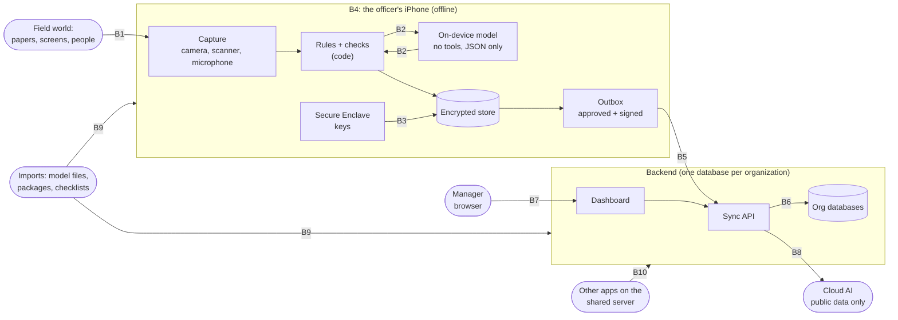

# Threat model

**Status:** first version, Nov 1 2026, on the architecture after the feasibility spikes. Not independently
reviewed. A guard (`scripts/check_threat_model.py`, run in CI) fails if a row claims a control that the repo
does not show: "built" must name an existing test or file, everything else must name the phase or issue that
fixes it.

**Method:** the four questions of the [Threat Modeling Manifesto](https://www.threatmodelingmanifesto.org/):
what are we working on, what can go wrong (STRIDE per trust boundary, LINDDUN for privacy, MITRE ATLAS for
AI), what are we doing about it, did we do a good job.

**Status words:** **built** (in the main code, with the test or the config file that enforces it), **spike** (proven on the real iPhone in a spike, to
be rebuilt test-first in the app), **planned** (decided, not built), **accepted** (a known limit, with the
reason).

## 1. What we are working on

Assets, by label ([data classification](data-classification.md)): mission evidence (photos, scans, voice,
transcripts, extracted facts, reports) is **Official Use Only** by default; device and mission keys never
leave the phone; public data only may reach cloud AI.

| Boundary | What crosses it |
|---|---|
| B1 Field world → phone | Documents, screens, speech: untrusted content that may carry instructions |
| B2 App ↔ on-device model | Untrusted text in, constrained JSON out |
| B3 App ↔ Secure Enclave | Signing and key-wrapping requests |
| B4 The phone itself | Everything at rest, on a phone that can be lost, stolen or seized |
| B5 Phone → network → backend | Approved, signed sync batches |
| B6 Backend ↔ organization databases | One organization's data |
| B7 Manager browser ↔ backend | Dashboard sessions and approvals |
| B8 Backend ↔ cloud AI | Public-labelled data only |
| B9 Imports (supply chain) | Model files, code dependencies, CI actions, checklists, mission packs |
| B10 The shared server (#103) | Other apps on the same machine, its nginx and Docker daemon, deploys, backups leaving the server |

## 2. What can go wrong, and what we do about it (STRIDE)

S spoofing, T tampering, R repudiation, I information disclosure, D denial of service, E elevation of privilege.

### B1 Field world → phone
| ID | STRIDE | Threat | Control | Status | Test or phase |
|---|---|---|---|---|---|
| T01 | S | A forged invoice is scanned as real | Every value must be printed on a scanned page (grounding, with the page and position kept as the fact's source); code reads the fixed labels itself and cross-checks the page against its own payment table and the bank's record; the officer confirms or corrects every fact, and a fact the pages do not print cannot be confirmed, only corrected (ADR 0009). Built in the app (#138) | built | `ios/MissionCopilotTests/FactGroundingTests.swift`, `ios/MissionCopilotTests/InvoiceChecksTests.swift`, `ios/MissionCopilotTests/FactConfirmTests.swift` |
| T02 | T | Hidden instruction in a scanned page (indirect prompt injection, ATLAS AML.T0051.001) | Model has no tools (T08), output is constrained JSON through the one model door, values grounded and cross-checked against the bank's records, the officer confirms every fact. Spike: the model obeyed 3 of 30 attacks, 0 of 30 got through the checks (docs/spikes/08-prompt-injection.md). In the app (#138): Vision reads each of the 18 printed attacks that plant a fact, the model is assumed to take the attacker's value, and the app's checks send all 18 to the officer; the clean pages give no problem | built | `ios/MissionCopilotTests/InjectionChecksTests.swift`, `ios/MissionCopilotTests/ScanExtractionTests.swift` |
| T03 | T | A fake second total that IS in the text passes grounding | Code reads the fixed labels itself (a value the model took elsewhere, or a label printed twice with two values, is a problem) and cross-checks against the bank's own records: rows add up, paid to date = bank's earlier payments + this invoice, contract value, amount fits what is left, date inside the contract, impossible values; approval only in the app. Built in the app (#138) | built | `ios/MissionCopilotTests/InvoiceChecksTests.swift`, `ios/MissionCopilotTests/InvoiceBankViewTests.swift`, `ios/MissionCopilotTests/InjectionChecksTests.swift` |
| T04 | T | A spoken number is misheard or injected | Spoken numbers are "heard" until the speaker confirms; cross-checked (ADR 0005). Measured in #48: the model garbles spoken numbers (negative values after one extra sentence), so read-back is required. Built in #142 with T74: code finds every spoken number, each is read back and confirmed or corrected, amounts checked against the pack | built | `ios/MissionCopilotTests/SpokenNumbersTests.swift`, `ios/MissionCopilotTests/DebriefReviewModelTests.swift` |
| T05 | I | A photo captures unrelated personal content (screens, bystanders) | Photos stay on the phone, sealed with the mission key; the camera is asked for only when the officer taps Take photo, and only the camera is used, never the photo library; the file is re-encoded with no metadata (no place, maker or lens inside it); logs keep counts only (#129) | built | `ios/MissionCopilotTests/EvidenceStoreTests.swift`, `ios/MissionCopilotTests/SitePhotoTests.swift`, `ios/MissionCopilotTests/PhotoEvidenceTests.swift` |
| T06 | D | Very long or malformed input stalls the model | Input length cap before the model (20,000 characters; a 130,000-character input took 158 s and obeyed a buried instruction) bounds the prefill, which cannot be interrupted; a 20 s time limit on every model call bounds the answer, and a stopped call is never used as facts (needs review). Built into the app's one door to the model (`FieldModel`, #136): every call goes through it. On the iPhone: normal pages answer in 3.6 s; with a 1 s limit the app got control back at 1.0 s and the model stopped by 1.75 s; the app's self-test answered in 2.8 to 6.9 s, 8 of 8 facts, offline | built | `ios/MissionCopilotTests/TimeLimitTests.swift`, `ios/MissionCopilotTests/FieldModelTests.swift`, `docs/spikes/results/time-limit-iphone13promax.json` |

### B2 App ↔ on-device model
| ID | STRIDE | Threat | Control | Status | Test or phase |
|---|---|---|---|---|---|
| T07 | T | Model output lowers a risk (e.g. hides MC-01) | Code computes every flag; the model never decides one (ADR 0005, 0010). The engine reads only the signed pack's figures and the phone's signed photos; it has no input for model text. Facts the model reads from a scan (6.5) will reach a rule only after the code's grounding checks and the officer's confirmation (#134) | built | `ios/MissionCopilotTests/RedFlagEngineTests.swift`, `ios/MissionCopilot/Platform/RedFlags/RedFlagEngine.swift` |
| T08 | E | Model takes actions (excessive agency, LLM06) | No tools, no network, no memory across documents; approval takes no document text (#48: 4 printed approvals could not approve). In the app (#136, #63): a model request holds only a prompt, a schema and a token cap, so there is nowhere to put tools; the tokenizer bridge passes no tools to the chat template whatever it is given; no chat session keeps history; a guard fails on any tool argument in the app's code. Proven offline on the iPhone in airplane mode | built | `scripts/test_model_no_tools.py`, `ios/MissionCopilotTests/FieldModelTests.swift`, `ios/MissionCopilot/Platform/AI/TokenizerBridge.swift` |
| T09 | R | Nobody can tell which text produced a value | Lineage in the store: each fact keeps its source evidence (a required database link) and rule version; each sentence its facts; trace() follows a sentence back to evidence; rows never change; changes are in a hash-chained audit log (ADR 0009). The approver and the time are in the signed approval (#163) | built | `ios/MissionCopilotTests/SentenceStoreTests.swift`, `ios/MissionCopilotTests/AuditLogTests.swift`, `ios/MissionCopilotTests/ReportApprovalStoreTests.swift` |
| T10 | I | One mission's data leaks into another's draft | The report is written by code from one mission's records only (its pack, walk, flags and facts, each read by mission id); Ask sends one mission's sources per prompt, a fresh session each time (#145, #161) | built | `ios/MissionCopilotTests/ReportModelTests.swift` (another mission's note stays out of the report and the facts to pick), `ios/MissionCopilotTests/MissionSourcesTests.swift` |
| T75 | T | An answer the mission's data does not back: asked a question, the model invents a number, a date or a status, writes the question back, or a planted note steers it, and the officer takes it for the mission's data | The model never writes an answer (ADR 0005, found on the iPhone): code answers the questions it knows from the pack's records (a payment by invoice number, the total paid, what is not done, whether something started, with both sides when the walk and the bank disagree, what was promised, the contract, the risk rating, red flags), and for any other question code writes one line from each record found by an offline keyword index (built in memory from signed and confirmed data, never stored, never fed by answers) and the model only chooses a label or none through a grammar; a record that speaks to the assistant is shown to the officer but never offered; earlier questions only steer the search; the sentence checks (numbers, dates, months, status words, opposites) stay as a guard (ADR 0005, ADR 0009, #145) | built | `ios/MissionCopilotTests/CodeAnswersTests.swift`, `ios/MissionCopilotTests/AnswerLinesTests.swift`, `ios/MissionCopilotTests/MissionAnswerTests.swift`, `ios/MissionCopilotTests/AskInjectionTests.swift` |
| T76 | T | An old answer passes as current: a kept answer is read after a newer pack or new confirmed facts changed what the data says | Each kept answer shows when it was asked and "based on the sources at that time", keeps the sources it cited as they were (a pack field with its file's hash); kept answers are sealed, append-only and gone only with their mission; a kept answer is never a fact (no red flag, note, report or later answer reads it); Ask again keeps a fresh answer as a new entry and the old one stays (#145) | built | `ios/MissionCopilotTests/AskLogTests.swift`, `ios/MissionCopilotTests/AskModelTests.swift` |
| T77 | T | A wrong correction becomes a fact: the model invents a scanned value, code locks Confirm, and the officer types the same invented value back in Correct (found on the iPhone, #151) | A correction is checked on the scanned pages like the model's values: the value the page check rejected is refused; a value found on a page is kept with its page and position; a value not on the pages needs a second tap for that same value and stays "typed by you, not on the page" in Ask and in the red flags; the values printed on the page are offered as one-tap choices | built | `ios/MissionCopilotTests/FactCorrectionTests.swift`, `ios/MissionCopilotTests/FactReviewModelTests.swift` |
| T78 | T | A debrief note says what was never said: the model rewrites the quoted words, adds a person or a deadline, or invents a note (found on the iPhone, #152) | No model writes or chooses debrief notes: code splits the transcript into the sentences said and labels each by cue words; a note is its sentence word for word, who and by when are words of it found by code, and NoteGrounding still checks every note; the officer confirms, relabels, edits or removes each one | built | `ios/MissionCopilotTests/DebriefCodeNotesTests.swift`, `ios/MissionCopilotTests/DebriefReviewModelTests.swift` |
| T79 | T | A report cites a bank record or a walk answer that was never there, or was changed after the walk | The pack and the finished walk are evidence items in the phone's signed chain (#162): the pack's item holds the exact manifest the server signed and that signature, the manifest pins each file by SHA-256, and each report fact names its file, pointer and hash or its question; the walk's item is added only after the finish, once; facts and sentences never change | built | `ios/MissionCopilotTests/ReportSourcesTests.swift`, `backend/tests/unit/test_evidence_v2.py` |
| T80 | T | A report sentence with nothing behind it is saved or approved: an officer types a claim, or a number not in the records | The report is written by code from facts, each sentence citing its facts (ADR 0005, #161); a sentence the officer adds or edits is checked against the facts they pick (numbers, dates, months, statuses, the main words); one with no fact or that fails shows "No proof" with the reason and the store refuses a draft holding it; drafts are append-only; the server refuses again any synced sentence without facts in the batch, or a fact without evidence in its chain (#172) | built | `ios/MissionCopilotTests/ReportDraftStoreTests.swift`, `ios/MissionCopilotTests/ReportWriterTests.swift`, `ios/MissionCopilotTests/ReportModelTests.swift`, `backend/tests/unit/test_sync_checks.py` |

### B3 App ↔ Secure Enclave
| ID | STRIDE | Threat | Control | Status | Test or phase |
|---|---|---|---|---|---|
| T11 | S | Someone signs evidence with the officer's key | Secure Enclave key, this device only, used only by our app; the signature also covers kind, clock source and location (payload v2, docs/evidence-format.md), and the server checks the format strictly | built | `ios/MissionCopilotTests/EvidenceChainTests.swift`, `ios/MissionCopilotTests/EvidenceSignerTests.swift`, `backend/tests/unit/test_evidence_v2.py` (verifies a chain signed on the iPhone), `docs/store-proof.md` |
| T12 | I | The private key is extracted | Accepted: the key never leaves the Secure Enclave (Apple platform guarantee) | accepted | Accepted: hardware guarantee, see Apple Platform Security |
| T13 | R | The final approval is signed without the officer present | A separate Secure Enclave approval key (`.privateKeyUsage` + `.userPresence`, only while the phone has a passcode) opened with a fresh context that reuses no earlier Face ID, so every approval asks Face ID or the passcode; one signature over canonical JSON of the saved draft (its sentences, facts, who, when); only the latest saved draft, only those exact bytes; a cancel or a failure approves nothing; one approval per mission, append-only, audited; afterwards nothing can be drafted over it (#163); the server keeps the approval key's public half with that phone, append-only, sent in a signed request, so a sync can check each approval and a key it never saw approves nothing (#171) | built | `ios/MissionCopilotTests/ApprovalSigningTests.swift`, `ios/MissionCopilotTests/ReportApprovalStoreTests.swift`, `ios/MissionCopilotTests/ReportModelApprovalTests.swift`, `ios/MissionCopilotTests/ReportStateTests.swift`, `backend/tests/unit/test_approval_key_route.py`, `ios/MissionCopilotTests/ApprovalKeyRegistrationTests.swift` |

### B4 The phone itself (lost, stolen, seized)
| ID | STRIDE | Threat | Control | Status | Test or phase |
|---|---|---|---|---|---|
| T14 | I | The database file is copied off a lost phone | SQLCipher with a random key in the Keychain (this device only) | built | `ios/MissionCopilotTests/EncryptedStoreTests.swift`, `ios/MissionCopilotTests/DataKeyStoreTests.swift`, `docs/store-proof.md` (sqlite3 on a Mac cannot open the phone's copy) |
| T15 | I | Data is read while the phone is locked | iOS Data Protection Complete; the store pauses reads and writes before the files lock | built | `ios/MissionCopilotTests/ProtectedFolderTests.swift`, `ios/MissionCopilotTests/StoreSuspensionTests.swift`, `docs/store-proof.md` (file unreadable while the iPhone was locked) |
| T16 | I | Mission data or models land in iCloud or computer backups | Data and model folders excluded from backup | built | `ios/MissionCopilotTests/ProtectedFolderTests.swift`, `ios/MissionCopilotTests/ModelStoreTests.swift` |
| T17 | I | An unlocked phone is in the wrong hands | App lock bound to the data key: Face ID or the passcode on cold start and after 2 minutes away; the same authentication releases the key (one prompt); locking drops the open store; a privacy cover in the app switcher. Checked on the iPhone | built | `ios/MissionCopilotTests/AppSessionTests.swift`, `docs/spikes/results/app-lock-iphone13promax.json` |
| T18 | I | The officer is forced to unlock the app | Least data on the phone; mission keys on a 14-day lease, crypto-shred when it ends or the clock is set back; visible, recorded shred (no hidden duress PIN); signed shred order to revoked phones; staff card: safety first (ADR 0012) | built | `ios/MissionCopilotTests/FieldShredTests.swift`, `ios/MissionCopilotTests/KeyLeaseTests.swift`, `backend/tests/unit/test_shred_order.py`, `ios/MissionCopilotTests/ShredOrderTests.swift` (the phone checks a real server order: pinned key, its own device id, issued within 5 minutes, then destroys and records), `ios/MissionCopilotTests/LocalServerE2ETests.swift` (end to end against the real server) |
| T19 | T | A mission must be destroyed now | Crypto-shred: delete the mission key, data unreadable at once | built | `ios/MissionCopilotTests/MissionKeysTests.swift`, `ios/MissionCopilotTests/FieldShredTests.swift`, `docs/store-proof.md` (shredded mission unreadable on the iPhone) |
| T20 | T | The evidence chain is rolled back to an older state | The server keeps each signed head and refuses a batch whose chain does not start with what it holds (#172) | built | `backend/tests/unit/test_sync_checks.py` |
| T21 | T | A jailbroken phone tampers with the app | Accepted for the prototype; production adds App Attest and MDM | accepted | Accepted: client checks are bypassable; see Limits |
| T22 | D | The phone is lost before sync | Accepted: losing unsynced data is safer than leaking it | accepted | Accepted: deliberate, see Limits |
| T23 | I | Debug tools ship in a release build | Lab screen and file sharing are Debug-only | built | `ios/Config/Info-Debug.plist` |

### B5 Phone → network → backend
| ID | STRIDE | Threat | Control | Status | Test or phase |
|---|---|---|---|---|---|
| T24 | I | Sync traffic is read in transit | TLS 1.2 or 1.3 at nginx, iOS requires modern TLS plus signed payloads; HSTS already on every production answer | built | `deploy/nginx/site.conf.template`, `backend/tests/unit/test_browser_and_hosts.py` |
| T25 | T | A payload is changed in transit or at rest | Secure Enclave signatures and hash chain, verified by the backend | built | `backend/tests/unit/test_evidence_chain.py` |
| T26 | S | A phone the organization never approved sends data | Enrollment: single-use hashed admin code, proof of key, manager approval (never their own), revocation; every request signed (trust on first use, see Limits); a code and a request number each pass once even when requests race | built | `backend/tests/unit/test_enroll.py`, `backend/tests/unit/test_device_admin.py`, `backend/tests/unit/test_device_requests.py`, `backend/tests/db/test_directory.py` |
| T27 | T | An old signed batch is replayed | Strictly increasing signed sequence number and a 5-minute time window per request; the batch idempotency key arrives with sync in Phase 8 | built | `backend/tests/unit/test_device_requests.py` |
| T28 | I | Unapproved data leaves the phone | The outbox holds approved, signed items only (ADR 0006); the server already refuses a batch whose report is not approved by a key it keeps for that phone, over exactly those sentences (#172, `backend/tests/unit/test_sync_checks.py`); the phone queues only an approved report, once, with one key (#173) | built | `backend/tests/unit/test_sync_checks.py`, `ios/MissionCopilotTests/ReportSendStoreTests.swift` |
| T29 | I | Key material crosses the network | The API contract never contains key references | built | `backend/tests/unit/test_openapi_contract.py` |
| T57 | T | A build reaches the wrong server: a Release pointed at staging or at a laptop, or the staging app holding production's keys or data | Three builds (#104), each its own settings file set after Base, so a laptop's Local.xcconfig can never win; Staging is its own app (own bundle id, so its own keychain, chip keys and pinned key); Release talks only to https://mc.lubot.ai. Checked three ways: the settings files, Xcode's own resolved settings for Staging and Release, and the app itself, which refuses any other host with a clear screen (no crash). Staging and Release never pin the same key | built | `scripts/test_ios_builds.py`, `scripts/test_check_ios_build_settings.py`, `ios/MissionCopilotTests/ServerConfigBuildTests.swift`, `ios/MissionCopilotTests/KeepGoingTests.swift` |
| T58 | D | Phones come back all at once after a restart and keep the server down (a retry storm), or a phone gives up for good | 429 and 502/503/504 pause a download, never fail it; Retry-After is honoured (seconds or an HTTP date) and kept between 5 seconds and 5 minutes, else a random wait under a doubling cap (full jitter); at most 5 tries in a row, then the person decides; only downloads (GET) repeat by themselves, each newly signed; the row shows the real wait | built | `ios/MissionCopilotTests/BackoffTests.swift`, `ios/MissionCopilotTests/MissionListRetryTests.swift`, `ios/MissionCopilotTests/ServerClientTests.swift` |
| T59 | D | A phone with a wrong clock is locked out: the server refuses a time outside 5 minutes like a bad signature, so the phone looks "not approved" | The phone measures the server's clock from GET /v1/health (not signed, no request number used, middle of the round trip) and signs with the server's time; after a refused GET it measures again and sends once more only if the clock really moved; a POST is never sent twice. The 5-minute window itself stays (T27) | built | `ios/MissionCopilotTests/ServerClockTests.swift`, `ios/MissionCopilotTests/LocalServerE2ETests.swift`, `backend/tests/unit/test_health_time.py` |
| T60 | T | An old app keeps talking to a server whose contract moved on | Every request carries the app's build (X-App-Build, a whole number that rises with every build handed out); below the server's minimum the answer is 403 app_too_old and the phone says "update the app"; nothing on the phone is deleted (only a valid signed shred order does that) and nothing is tried again by itself | built | `ios/MissionCopilotTests/AppTooOldTests.swift`, `ios/MissionCopilotTests/MissionListModelTests.swift`, `backend/tests/unit/test_app_too_old.py` |
| T69 | T | A thief sets a stolen phone's clock wrong so it refuses its genuine shred order as "not recent" and keeps its missions (found on the iPhone, #94) | The order's age is judged by the server's time the phone measured (Connection.serverNow), never the phone's own clock; a script check refuses any shred handler that passes the phone's clock | built | `ios/MissionCopilotTests/ConnectionTests.swift`, `scripts/test_ios_builds.py` |
| T70 | S | A revoked phone keeps its chip key, so it can still sign requests after its shred, and it can never connect again because the server never takes a known key (found on the iPhone, #94) | A shred deletes the chip key with the enrollment; a new connection always starts from a fresh key | built | `ios/MissionCopilotTests/EnrollmentTests.swift` |
| T71 | I | A mission sent again after a shred brings the destroyed data back, or its new data can never be destroyed (one shred record per mission ever, found on the iPhone, #94) | Mission lives (schema v10, ADR 0008): one append-only shred event per life; the next life starts under a fresh key, the shredded rows stay unreadable and are removed, the next shred destroys the new life; a pack older than one accepted before the shred is still refused | built | `ios/MissionCopilotTests/PackImportTests.swift`, `ios/MissionCopilotTests/AppendOnlyTests.swift` |
| T72 | T | A red flag is changed, removed or added after the walk, to hide or invent a risk | Stored at the finish in the finish's own transaction; database triggers refuse any insert after the finish and any update or delete while the mission exists; the detail is sealed with the mission key; the audit log names each raised rule (#134) | built | `ios/MissionCopilotTests/RedFlagStoreTests.swift` |
| T73 | T | A threshold or rule is changed to hide a flag | The rules file ships inside the signed app and is read strictly (an unknown field, unit or version is refused); a guard keeps it on ADR 0010's rules and sources; a pack cannot change it; a rule the app cannot compute shows as not checked, never clear (#134) | built | `ios/MissionCopilotTests/RedFlagRulesTests.swift`, `scripts/test_check_red_flag_rules.py` |
| T74 | T | A wrong spoken number becomes a fact: the speech engine mishears ("480,000 hours", "$85 million" for 8.5 million) with no warning, or the model writes a date that was never said | Spoken numbers are "heard", never facts: code finds every number, amount, percent and date in the transcript (digits and words, English and French) and shows each with the words around it for the officer to confirm or correct; amounts are checked against the pack (an invoice's amount, the bank's payments, the road's length); each drafted note must quote words that were said, and a number or month in it that was never said is a problem; nothing is stored until the officer decided every note and number (ADR 0005, #142) | built | `ios/MissionCopilotTests/SpokenNumbersTests.swift`, `ios/MissionCopilotTests/NoteGroundingTests.swift`, `ios/MissionCopilotTests/DebriefConfirmTests.swift` |

### B6 Backend ↔ organization databases, and the API in front of them
| ID | STRIDE | Threat | Control | Status | Test or phase |
|---|---|---|---|---|---|
| T30 | S | Unauthenticated calls | ES256 bearer token from one issuer on every route except health; secured router by default; every failure the same 401 | built | `backend/tests/unit/test_auth.py` |
| T31 | E | Organization A reads organization B (BOLA, API1:2023) | Organization only from the token; one physical Postgres database per organization with its own owner and app login, so one organization's login cannot even connect to another's; inside it, forced row-level security per mission team (another team's mission answers like a missing one); a cross-tenant test on every route | built | `backend/tests/unit/test_tenancy.py`, `backend/tests/db/test_org_databases.py`, `backend/tests/db/test_row_security.py` |
| T32 | I | Shared storage between organizations | One physical Postgres database per organization (#88, ADR 0008): its owner role cannot log in, its app login can use rows but not change tables, and one organization's login cannot connect to another's database or any other; what must be found before the organization is known (phones, codes, the security audit log) lives in a shared directory that holds ids, never mission data | built | `backend/tests/db/test_org_databases.py`, `backend/tests/unit/test_tenancy.py` |
| T33 | E | One mission team sees another team's mission | Row-level security per mission team, forced in Postgres; managers read only through their own read policies (#175) | built | `backend/tests/db/test_row_security.py`, `backend/tests/db/test_dashboard_data.py` |
| T34 | D | Brute force, bots, flooding | Rate limit per client with 429 and Retry-After, capped memory; 1 MiB body limit, chunked bodies counted | built | `backend/tests/unit/test_limits.py` |
| T35 | I | API docs pages hand out the attack map | `/docs`, `/redoc`, `/openapi.json` off in production; production is the default | built | `backend/tests/unit/test_app_surface.py` |
| T36 | T | Unexpected fields change stored data (mass assignment) | Strict input: unknown fields rejected, a guard checks every request body; errors never echo input or leak a crash | built | `backend/tests/unit/test_errors_and_input.py` |
| T37 | I | Routes exist that the contract does not describe | A test that every served route, routers included, is in the contract | built | `backend/tests/unit/test_app_surface.py` |
| T38 | R | No record of security events | Append-only, hash-chained audit log; never tokens or bodies; kept in the directory database, where a trigger refuses any change or removal and the chain still names an entry changed behind it | built | `backend/tests/unit/test_audit.py`, `backend/tests/db/test_audit_log.py` |
| T39 | I | A database backup is stolen | Backups are restic repositories, encrypted at rest (AES-256) with a password kept off the box, stored off the server (B2), restored into a throwaway Postgres every week; checked on production Nov 11 2026. One password per environment, not per organization | built | `scripts/mc_backup.py`, `scripts/test_mc_backup.py` |

### B7 Manager browser ↔ backend
| ID | STRIDE | Threat | Control | Status | Test or phase |
|---|---|---|---|---|---|
| T40 | S | A manager's session is stolen | Passkeys (Touch ID; no password to steal or phish); the session is a `__Host-` cookie, Secure, HttpOnly, SameSite=Strict, 8 hours, kept on the server only as its SHA-256 and removed at sign-out; the institution's single sign-on in a real deployment (ADR 0014, #174) | built | `backend/tests/unit/test_dashboard_routes.py`, `backend/tests/db/test_dashboard_store.py` |
| T41 | T | Script injection or clickjacking on the dashboard | The dashboard's own Content Security Policy (this server only: no inline script, no other host), frame-ancestors none, every value escaped in server-built pages (#174) | built | `backend/tests/unit/test_dashboard_pages.py` |
| T42 | T | A forged "approve" request (CSRF) | SameSite=Strict session cookie, and every dashboard POST must carry the dashboard's own Origin, else 403 (OWASP) (#174) | built | `backend/tests/unit/test_dashboard_routes.py` |
| T43 | R | A manager denies having endorsed or sent back a report | Every decision is kept append-only in the organization's database with who and when, the SHA-256 of the approval it decided on and, for an endorsement, the passkey's assertion as it came (Touch ID, user verification required, over a challenge naming that manager and that report version); one final decision per version; each is also written to the hash-chained audit log, and the audit trail page shows "Chain intact" only when the log verifies again (#178) | built | `backend/tests/db/test_reviews.py`, `backend/tests/unit/test_endorse_passkey.py`, `backend/tests/unit/test_review_routes.py`, `backend/tests/unit/test_dashboard_trail_page.py` |
| T82 | E | A manager endorses their own mission's report, or a report other than the one they read | Postgres refuses a decision by anyone on the mission's team (row-level policy), and the server says so before; the endorse challenge names the mission, the version and the approval's SHA-256, so it cannot endorse another report or a later version; only a report whose stored Face ID approval verifies again with the kept key can be decided (#178) | built | `backend/tests/db/test_reviews.py`, `backend/tests/unit/test_endorse_passkey.py`, `backend/tests/unit/test_review_routes.py` |
| T83 | I | A red flag, or a file only red flags cite, reaches a manager not cleared for strictly confidential content | The report page leaves out strictly confidential sentences and facts (their words never reach the page) unless the manager has the `confidential` role, given only by the operator at invite (`--confidential`); a file cited only by strictly confidential facts is 404 for everyone else; files are served only to a signed-in manager of that organization, never cached, their type taken from their bytes (#177) | built | `backend/tests/unit/test_dashboard_report_page.py`, `backend/tests/db/test_dashboard_report.py`, `backend/tests/db/test_admin_dashboard.py` |
| T81 | S | A manager is phished, or a passkey is copied | Passkeys are bound to the dashboard's origin (a look-alike site gets nothing), need user verification to register, and a sign count that does not rise is refused; an invite is a one-time code for one person, 15 minutes, kept only as its SHA-256; every challenge is the server's, once and for one purpose (#174) | built | `backend/tests/unit/test_passkeys.py`, `backend/tests/db/test_admin_dashboard.py` |
| T53 | T | Another website calls the API from a browser, or a forged Host header | CORS only for the dashboard origin, no credentials; unknown hosts refused; nosniff, no framing, a 'none' content policy, no-referrer, no-store and HSTS on every answer | built | `backend/tests/unit/test_browser_and_hosts.py` |
| T54 | T | A genuine pack carries a checklist crafted to break or mislead the app | The pack's signature proves who sent it, not that its checklist is safe. The contract allows only the columns and types the app reads, English and French, and limits (200 questions, 500 choices, 1,000 characters a text, 500 an expression). The phone then refuses, with the row, a form nobody could fill (an unknown type, a name used twice, a missing list, a group without its pair, groups over 3 deep, a ${name} that names no question). Expressions are read by a parser of our own, never run as code, capped at 500 characters and 32 deep; a regex() pattern over 200 characters or with backreferences or lookbehind refuses the form, and every regex runs with a 50 ms budget on at most 1,000 characters. A rule the app cannot read never blocks: the question shows and is marked unchecked. The server checks the same before it publishes, held to one shared case file with the phone | built | `ios/MissionCopilotTests/ChecklistFormTests.swift`, `ios/MissionCopilotTests/ChecklistExpressionTests.swift`, `ios/MissionCopilotTests/ChecklistEvaluatorTests.swift`, `ios/MissionCopilotTests/ChecklistRulesTests.swift`, `ios/MissionCopilotTests/ChecklistSharedCasesTests.swift`, `backend/tests/unit/test_checklist_check.py`, `scripts/test_checklist_cases.py`, `docs/api/fixtures/checklist-form-cases.json` |
| T55 | I | Half-downloaded pack files are read on a phone that is locked but was unlocked once since it started | They exist only while a pack downloads: protected until first unlock (a download goes on while the phone is locked, and a Complete file cannot be written then), never backed up, named by hash inside the app, checked before use; removed only after the import into the encrypted store has committed; a folder left behind (a failed delete, or a pack that waited for unlock) is removed the next time the mission list opens, and the end to end test checks the folder is gone | built | `ios/MissionCopilotTests/PackStagingTests.swift`, `ios/MissionCopilotTests/PackImportTests.swift`, `ios/MissionCopilotTests/MissionListModelTests.swift`, `ios/MissionCopilotTests/LocalServerListSteps.swift` |
| T56 | D | An .xlsx form crafted to attack the server while it is converted (a huge or malformed workbook, XML entity tricks) | Only an admin runs the conversion, from the command line (no upload route yet); a file over 5 MB is refused before it is read; pyxform reads the workbook with openpyxl in read-only mode and defusedxml, which refuses XML entity attacks; the result must pass the whole checklist check before it can be published. A zip that expands far beyond 5 MB is not capped yet: planned with the upload route | built | `backend/tests/unit/test_checklist_xlsx.py`, `backend/tests/unit/test_admin_checklist.py` |

### B8 Backend ↔ cloud AI
| ID | STRIDE | Threat | Control | Status | Test or phase |
|---|---|---|---|---|---|
| T44 | I | Official Use Only data is sent to cloud AI | Label check before every call, a test for every label and task (ADR 0003); labels inherit the strictest source. No cloud AI is called from the phone yet (the model runs on the phone); the label rules are built | planned | Phase 9 (only if a cloud AI call is ever added) |
| T45 | I | The cloud provider keeps prompts | Only public data is ever sent; no cloud AI in the demo path | accepted | Accepted: public data only, nothing sensitive to keep |

### B9 Imports and supply chain
| ID | STRIDE | Threat | Control | Status | Test or phase |
|---|---|---|---|---|---|
| T46 | T | A model file is swapped or changed (ATLAS AML.T0010) | OpenSSF Model Signing bundle over every file, checked with CryptoKit before import and before every load; key pinned; safetensors only. The model ships inside the signed app (#125): the build copies only the signed files, and the app still checks them before it trusts them (verified, not in this build, or refused), proven on the iPhone | built | `ios/MissionCopilotTests/ModelSignatureTests.swift`, `ios/MissionCopilotTests/ModelStoreTests.swift`, `ios/MissionCopilotTests/BundledModelTests.swift`, `scripts/test_bundle_model.py` |
| T47 | T | A dependency has a known vulnerability | pip-audit on every PR and weekly; CodeQL (Python, Actions; Swift weekly); Dependabot with a 7-day cooldown | built | `.github/workflows/security.yml`, `.github/dependabot.yml` |
| T48 | T | A compromised CI action steals secrets | Actions pinned to commit SHAs, minimal token permissions, zizmor lint | built | `.github/workflows/ci.yml` |
| T49 | I | A secret is committed | gitleaks on every commit and in CI over the full history | built | `.github/workflows/ci.yml` |
| T50 | T | The SQLCipher database library (our GRDB fork) drifts | Pinned revision, recorded in the SBOM; a commit check fails if Package.resolved and the SBOM differ | built | `scripts/test_check_bom.py` |
| T51 | T | A malicious or old mission pack is imported | Packs signed by the server (P-256 over a pack label and the exact manifest bytes), every file listed by SHA-256 and size, limits in the contract (64 files, 20 MiB a file, 50 MiB a pack, fixed folders), versions only go up, expiry; served only to the mission's team. The phone checks the same before it keeps anything: the signature with a pinned key and the pack label, the contract's rules again after the signature, the key id, expiry and app version, the mission and organization it asked for, a version above the last one it accepted (a genuine older pack played back is refused), free space for three times the pack, then each file's size and SHA-256. Before the pack is kept, every section and the checklist must match the contract's schema (an unknown field refused), every staged file is hashed again, and the version rule runs again inside the one transaction that stores it. Every piece is its own freshly signed request: no background session, which would send old signed requests again (T27) | built | `backend/tests/unit/test_pack_verify.py`, `backend/tests/db/test_packs.py`, `backend/tests/db/test_pack_routes.py`, `ios/MissionCopilotTests/PackVerifierTests.swift`, `ios/MissionCopilotTests/PackAcceptanceTests.swift`, `ios/MissionCopilotTests/PackDownloaderTests.swift`, `ios/MissionCopilotTests/PackSectionsTests.swift`, `ios/MissionCopilotTests/PackImportTests.swift`, `ios/MissionCopilotTests/LocalServerPackSteps.swift`, `ios/MissionCopilotTests/LocalServerListSteps.swift` |
| T52 | T | The model was poisoned upstream (ATLAS AML.T0020) | Frozen public model, source, revision, hash and license in the ML-BOM (checked against the signature), outputs checked by code | built | `docs/sbom/app.cdx.json`, `scripts/test_check_bom.py` |

### B10 The shared server (#103, ADR 0013)
| ID | STRIDE | Threat | Control | Status | Test or phase |
|---|---|---|---|---|---|
| T61 | I | Another app on the same server reads MissionCopilot's secrets or data | Nothing shared with other apps (own containers, networks, volumes, database, nginx file, certificate, backups); own uids that no other process uses (10120 the server, 10121 Postgres: the images' 999 and the usual 10001 were other apps' there); every secret file 0600 with one owner; Postgres has no port; the API listens on loopback only | built | `scripts/container_check.py`, `backend/tests/unit/test_deploy_compose.py` |
| T62 | S | A client writes its own X-Forwarded-For to share or escape a rate limit, or to put a false address in the audit log | The API believes the header only from its own network's gateway (the host's nginx), never `*`; nginx overwrites it with the real address; behind the proxy only the rightmost untrusted address counts | built | `backend/tests/unit/test_process_settings.py`, `scripts/nginx_check.py`, `scripts/container_check.py` |
| T63 | D | A bad image or a restart takes the server down, or phones hammer it while it is down | Deploys by digest only, with a readiness check and an automatic way back to the previous image; pools replace broken connections after a database restart; nginx answers a JSON 503 with Retry-After while the API is down, a JSON 429 with Retry-After for floods | built | `scripts/test_mc_deploy.py`, `scripts/container_check.py`, `backend/tests/db/test_pool_restart.py` |
| T64 | D | The data is lost (a lost server, an operator's mistake) and the backups cannot be read | Nightly encrypted backup (restic) of every database, the roles and the secrets to the environment's own private bucket; every week the latest is restored into a throwaway Postgres and a tenth of the stored data read back; a live restore brings each database back with its own rules; the restic password is also kept off the server | built | `scripts/test_mc_backup.py`, `scripts/test_systemd_units.py`, `scripts/container_check.py` |
| T65 | I | Weak or old TLS between the phone and the server | nginx offers TLS 1.2 and 1.3 only, forward-secret AEAD ciphers, a Let's Encrypt certificate; TLS 1.0 and 1.1 refused (checked against the live server); the app's ATS has no exception outside Debug; SSL Labs A+ on staging (#103 step 7) | built | `scripts/test_render_nginx_site.py`, `scripts/test_ios_builds.py` |
| T66 | T | A tampered or vulnerable server image is deployed | Built only by CI, natively; every base and tool pinned by digest; checked with the real Compose file and scanned (Grype, its checksum written in the workflow, a fixable high or critical finding fails); pushed only from main, only the checked image, with a provenance attestation; deployed only by digest | built | `backend/tests/unit/test_image_workflow.py`, `backend/tests/unit/test_container_image.py` |
| T67 | E | A broken-into API or Postgres container reaches the server or the internet | Read-only root, no capabilities, no new privileges, its own non-root uid, memory, CPU and process limits; Postgres on an internal network with no way out; no Docker socket anywhere | built | `scripts/container_check.py`, `backend/tests/unit/test_deploy_compose.py` |
| T68 | E | Someone who controls the server (root, or its Docker daemon) controls MissionCopilot's containers, secrets and signing key | Accepted for the demo: the server is shared (ADR 0013); access only over the admin VPN; the prod spare signing key is kept off the server, so a key rotation needs no new app. For real users: a server of its own and the signing key in a hardware key store (ADR 0008) | accepted | ADR 0013 and ADR 0008: a shared server is a demo choice, revisited before real users or real data |

## 3. Privacy (LINDDUN)

| ID | LINDDUN | Threat | Control | Status | Test or phase |
|---|---|---|---|---|---|
| P01 | Linking | Evidence across missions traces a person's movements | Per-mission keys; only active missions on the phone, keys expire on a lease (spike, #49); purged after sync plus retention; the server keeps approved results only | planned | Phase 9 (purge after sync) |
| P02 | Identifying | Voice and photos identify bystanders or informants | A consent line before every recording ("only myself, or people who agreed"); the microphone only while recording; the audio kept as sealed, signed evidence (decided B, #142), never leaving the phone unapproved, gone with its mission; photos only when the officer taps Take photo, no metadata kept | built | `ios/MissionCopilotTests/DebriefModelTests.swift`, `ios/MissionCopilotTests/DebriefStoreTests.swift`, `ios/MissionCopilotTests/SitePhotoTests.swift` |
| P03 | Non-repudiation | **Signed evidence proves who sent it, which can hurt staff who were coerced** | Signatures prove the device, not free will (ADR 0009); ADR 0012 staff card: safety first, comply, no hidden wipe; the organization revokes the phone and the shred order destroys its missions | accepted | A named trade-off: accountability needs signed evidence, and the staff card plus the shred order limit the harm to coerced staff |
| P04 | Detecting | A seized phone reveals that a mission exists | Encrypted database hides even table names; crypto-shred | built | `ios/MissionCopilotTests/EncryptedStoreTests.swift`, `ios/MissionCopilotTests/FieldShredTests.swift`, `docs/store-proof.md` (no table name in the phone's database bytes) |
| P05 | Data disclosure | Official Use Only data reaches cloud AI | Same control as T44 | planned | Phase 9 (only if a cloud AI call is ever added) |
| P06 | Unawareness | The officer does not know what will be sent | The officer reads every sentence with its proof and approves it with Face ID on the phone (#163, built); before Send, the phone says exactly what goes (sentences, facts, evidence items, files, size) and that nothing else leaves it (#173) | built | `ios/MissionCopilotTests/ReportModelSendTests.swift` |
| P07 | Non-compliance | Data kept longer than needed | Retention clock starts at server confirmation (30 days, set per organization), then crypto-shred; key lease as a backstop; every item's retention in docs/data-handling.md, checked by `scripts/test_check_data_handling.py` | planned | Phase 9 (retention clock from the receipt) |
| P08 | Linking | Recording places on a site walk tracks the officer's movements | Location only when the officer taps Record location (asked then, while using the app), one reading per tap, never in the background; kept sealed in that one answer with the mission key, so a shred makes it unreadable (#129) | built | `ios/MissionCopilotTests/PlaceTests.swift`, `ios/MissionCopilotTests/SiteWalkStoreTests.swift` |

## 4. AI-specific mapping

**Design position:** the on-device model reads untrusted text but has no tools, no network and no memory
across documents; code decides every fact and flag; a person approves before anything leaves. This is the
"no consequential action" case in the prompt-injection design patterns of
[Beurer-Kellner, Tramèr et al. 2025](https://arxiv.org/abs/2506.08837). Constrained JSON guarantees the
shape, not the truth: an injected document can still steer which valid value the model picks, so the
defense is grounding plus code cross-checks plus human approval (T01-T03).

| OWASP LLM Top 10 (2025) | Here |
|---|---|
| LLM01 Prompt injection | T02, T03, T04; measured in #48 |
| LLM02 Sensitive information disclosure | T10, T44 |
| LLM03 Supply chain | T46, T52 |
| LLM04 Data and model poisoning | T52 (no training or fine-tuning on mission data) |
| LLM05 Improper output handling | Output is JSON checked by code, never executed (T07) |
| LLM06 Excessive agency | T08: no tools |
| LLM07 System prompt leakage | Low impact: the prompt holds no secrets |
| LLM08 Vector and embedding weaknesses | T75: a keyword index (no embeddings), built in memory from the signed pack and confirmed records only, never stored, never fed by answers; the model only chooses among lines code wrote |
| LLM09 Misinformation | T01, T03, T07, T75, T76, lineage T09 |
| LLM10 Unbounded consumption | T06 |

OWASP Top 10 for Agentic Applications (2026): mostly **not applicable by design** (no tools, no agents
talking to each other, no autonomous actions); goal hijack and human-agent trust exploitation map to T02 and
the approval gate (T28). ATLAS ids come from the [MITRE ATLAS](https://atlas.mitre.org/) matrix; check them
against the current release before quoting.

## 5. Mapping to OWASP Mobile Top 10 (2024) and API Security Top 10 (2023)

| Mobile | Rows | API | Rows |
|---|---|---|---|
| M1 Credential usage | T11, T49 | API1 Object-level authorization | T31 |
| M2 Supply chain | T46-T52 | API2 Authentication | T30, T26 |
| M3 Authentication / authorization | T17, T26 | API3 Object property authorization | T36 |
| M4 Input / output validation | T01-T07, T51, T54, T56 | API4 Resource consumption | T34, T58 |
| M5 Communication | T24, T25, T57, T59 | API5 Function-level authorization | T31, T33 |
| M6 Privacy controls | P01-P07 | API6 Sensitive business flows | T42, T43 (approval) |
| M7 Binary protections | T21 (accepted) | API7 Server-side request forgery | Not applicable: no URL fetching |
| M8 Misconfiguration | T23, T35, T57 | API8 Misconfiguration | T35, T41, T53 |
| M9 Data storage | T14-T16, T19, T55 | API9 Inventory management | T37, T60 |
| M10 Cryptography | T14, T19, T25 | API10 Unsafe consumption of APIs | T45 |

## 6. Limits we accept (and the production upgrade)
- **Device identity is trust on first use.** With a free Apple ID there is no App Attest, so the server
  cannot prove that a key lives in a Secure Enclave or that the app is unmodified. Enrollment is the
  control: a one-time code, proof of the key, and a manager's approval (see security.md). Production: a paid Apple developer team, App Attest and device management (MDM). Free signing
  also expires every 7 days, which a field deployment cannot accept.
- **An unlocked, compromised or jailbroken phone** can read what the app can read (T17, T21).
- **Unsynced data on a lost phone is gone** (T22), on purpose.
- **Remote wipe needs the phone to come online**, or MDM (T18).

## 7. Did we do a good job?
- The guard keeps every row honest; it runs in CI.
- Review again at the end of each phase, and whenever a trust boundary or a data flow changes.
- Next review: Iteration 3 review (#50).
